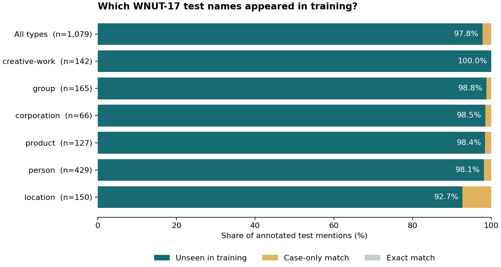

# Compare extraction on labeled domains

Use this panel to ask whether a change recovers exact entity mentions across subjects and genres. Each eligible input contributes one independently annotated mention. The discovery and reserved halves have the same per-domain budget and disjoint input texts. Keep the reserved fixtures sealed until the candidate and the decision rule are frozen.

| Groups | Source and annotation |
|---|---|
| AI, literature, music, politics, science | Five CrossNER topics share an encyclopedia genre. Only general person, organization and location labels are eligible. [CrossNER test files](https://github.com/zliucr/CrossNER/tree/2e7ba2a7798c961e3f29fbc51252c5a8d40224bf/ner_data) |
| Reuters news | Person, organization and location labels in the CoNLL-2003 test data distributed with CrossNER. [Snapshot](https://github.com/zliucr/CrossNER/tree/2e7ba2a7798c961e3f29fbc51252c5a8d40224bf/ner_data/conll2003) |
| Social posts | WNUT-17 person, corporation and location annotations. [WNUT test file](https://github.com/leondz/emerging_entities_17/blob/e52a2d2a71ac1a051ca2d532eef28653c5c02603/emerging.test.annotated) |
| Flight and assistant queries | ATIS city, state and country name slots, including directional variants. SNIPS city, state and country slots. Both are rendered as LOC. [JointBERT test files](https://github.com/monologg/JointBERT/tree/00324f60dda4a491b2913bc3065ae93966caea3f/data) |
| Contracts | Source-aligned CUAD Parties answers with company suffixes. Each contract contributes at most one window with up to 250 characters of surrounding context per side. [CUAD release](https://github.com/TheAtticusProject/cuad/tree/67faa0e6023b04fcaae6cc09497ab00e5d63a2a2) |

The [source catalog](../scripts/qa/domain-sources.json) lists exact upstream files, revisions and hashes. The thirteen groups above use developer-provisioned inputs. Use them only when your authorization covers the intended evaluation. A pinned public mirror identifies bytes without establishing permission for automatic acquisition, hosted processing, redistribution, or model prompts.

The Atticus Project licenses CUAD under CC BY 4.0 and disclaims warranties on the underlying third-party agreements. Its source is SEC EDGAR. The CUAD manifest credits the dataset and describes how the labels were adapted. Keep contract windows and predictions that reproduce them in local replay. Sharing complete passages requires a separate basis for the underlying contract and a check for incidental names, signatures, addresses or contact details. [CUAD v1](https://doi.org/10.5281/zenodo.4595826) · [Publisher’s terms](https://huggingface.co/datasets/theatticusproject/cuad-qa#licensing-information)

## Test recognition of unfamiliar names

If your application needs to recognize a person or product the first time someone mentions it, WNUT-17 gives you a way to test that ability. The figure compares all six entity types in the full `emerging.test.annotated` file with the names annotated in `wnut17train.conll`. The social-posts panel above samples three of those types.



A dictionary built from the annotated training names could match zero test mentions exactly. Ignoring case raises its ceiling to 24 of 1,079, even with perfect span boundaries and any training label accepted. For a backend comparison, count how many of the remaining 1,055 mentions each backend finds with the correct span and label. Also report false positives on the full test file. “Unseen” here refers to the WNUT training annotations. A pretrained model may have encountered the name elsewhere. [WNUT-17, Derczynski et al. (2017)](https://aclanthology.org/W17-4418/) · [Dataset snapshot](https://github.com/leondz/emerging_entities_17/tree/e52a2d2a71ac1a051ca2d532eef28653c5c02603) · [Reproduce the figures](../scripts/README.md#reproduce-the-dataset-figures)

## Run the hosted panel locally

The weekly/manual job uses the Snips publisher’s two validation files for weather and restaurant queries (100 queries each). These have distinct catalog IDs from the lowercased third-party SNIPS BIO split. Preserve the original case, punctuation and spaces; map the publisher’s city, state and country slots to exact LOC assertions. Both intents come from the same English query benchmark. The receipt records the source pins, authors, license, adaptation and split sizes. [Dataset and citation request](https://github.com/sonos/nlu-benchmark/blob/b86ac7f1577868c42158d0dec77db50956046696/2017-06-custom-intent-engines/README.md) · [CC0 1.0](https://github.com/sonos/nlu-benchmark/blob/b86ac7f1577868c42158d0dec77db50956046696/LICENSE)

Coucke A. et al., *Snips Voice Platform: an embedded Spoken Language Understanding system for private-by-design voice interfaces*, 2018. [Paper](https://arxiv.org/abs/1805.10190)

```sh
data=.generated/anno-qa/domain-sources
panel=.generated/anno-qa/snips-validation
python3 scripts/qa/prepare_domain_fixtures.py fetch "$data" --group hosted
python3 scripts/qa/prepare_domain_fixtures.py prepare "$data" "$panel" --group hosted --per-split 8
```

Each source was reviewed for fetching and scoring on a hosted runner and publishing aggregate results. Raw utterances, detailed predictions and both generated splits stay on that runner. The published artifact contains `domain-discovery.json` and `domain-manifest.json`. Web coverage is reported separately in `documents-summary.json`, `feeds-summary.json` and `publishers-summary.json`. Those files give the seed, selected catalog sources and counts; detailed reports, discovered URLs and free-form diagnostics stay local. An unmet discovery assertion is recorded as a measurement. Input and execution errors fail the job.

## Prepare another authorized local panel

Place the exact files you are entitled to use under the names from the catalog. The acquisition command handles only the two reviewed publisher sources above. For CUAD, use the archive's `test.json` as `cuad.json`. Preparation verifies the uncompressed file hashes offline.

```sh
panel=.generated/anno-qa/domain-panel
just qa-prepare-domains "$data" "$panel"
```

The default selects up to 32 discovery and 32 reserved inputs per domain. Set the two trailing recipe arguments to change the per-split budget and seed. Preparation requires a new output directory. To use only selected local sources, run `python3 scripts/qa/prepare_domain_fixtures.py prepare "$data" "$panel" --domain atis --domain snips`.

`manifest.json` records the source families, SHA-256 pins, seed, eligible records, unique eligible texts after exclusions, actual split sizes and any shortfall per domain. Cases are ranked deterministically within each group. When a group falls short of budget, the available inputs are divided evenly, with the odd extra input assigned to discovery. Exact duplicate inputs are allocated once across the panel. Changing the source selection can therefore change membership. The English token/tag sources reconstruct text with one space between tokens and preserve case. The resulting offsets refer to that exact UTF-8 source interpreted as Unicode characters. Different sentences can come from the same article.

## Add Dutch, Spanish and Chinese

The optional `multilingual` group selects Dutch and Spanish CoNLL-2002 news and Chinese WeiboNER social posts. Use a separate output directory. Use `prepare --group all` to include all thirteen local domains. The historical `just qa-prepare-domains` recipe selects the ten English groups. Both direct Python commands default to the hosted group.

```sh
panel=.generated/anno-qa/multilingual-panel
python3 scripts/qa/prepare_domain_fixtures.py prepare "$data" "$panel" --group multilingual
```

Offline, extract `conll2002/ned.testb` and `conll2002/esp.testb` from the pinned archive as `conll2002-nl.bio` and `conll2002-es.bio`. Save the pinned Weibo test file as `weibo-zh.bio`. The news inputs discard document markers and POS columns, join tokens with a single space and retain PER, ORG and LOC. The Weibo inputs remove each character's word-position digits and join the source characters without spaces. They preserve literal spaces, digits and replacement characters. Named people, organizations and locations are eligible, with named geopolitical entities included under LOC. Nominal mentions are excluded. The public test sets have different annotation conventions and their overlap with model training data is generally unknown. [CoNLL-2002 archive](https://github.com/nltk/nltk_data/blob/5f09e470fe339e1a119dd174ca284129a3c7a5bb/packages/corpora/conll2002.zip) · [WeiboNER second-release test file](https://github.com/hltcoe/golden-horse/blob/7a73c08e45ed94312af4ef2d97cc35a47d029e99/data/weiboNER_2nd_conll.test)

Run the paired checker below on these fixtures to measure one exact positive anchor per input. The earlier 192-record multilingual experiment selected 64 records per language before looking at their annotations, included gold-empty records and scored every eligible gold mention and prediction. Its precision, recall and F1 have different denominators.

## Run a paired comparison

Set `BASELINE` and `CANDIDATE` to the executables under comparison. On a new fixture, the baseline normally misses some anchors. The checker still saves its source-bound results when it exits 1 for an unmet assertion. Keep exit 2 for invalid input or execution failures.

```sh
fixture="$panel/discovery.json"
checker=scripts/qa/check_span_assertions.py
base_rc=0
python3 "$checker" --fixture "$fixture" --binary "$BASELINE" --model stacked \
    --save-predictions "$panel/base.jsonl" > "$panel/base-report.json" || base_rc=$?
if [ "$base_rc" -gt 1 ]; then exit "$base_rc"; fi

python3 "$checker" --fixture "$fixture" --binary "$CANDIDATE" --model stacked \
    --baseline-predictions "$panel/base.jsonl" > "$panel/paired-report.json"
```

The combined checker report lists per-domain denominators and paired gains and losses under `domains`, using the explicit `domain` field on each fixture case. Its findings identify the individual assertions that changed. Keep separate prediction/report paths when repeating the commands on `reserved.json`. Run `just qa-round "$panel/paired-report.json" 'Which domain has paired losses?'` to pass aggregated findings to the coordinator. The normal [round tracer](ADVERSARIAL_QA.md) can record the commands and their input/output digests.

The measured quantity is exact recall on selected labeled anchors. Other mentions and predictions are unjudged. Inputs with no eligible anchor are excluded, so the panel cannot estimate precision or false alarms on empty documents. A change that fails to improve these anchors may still improve a specific extraction pattern. Freeze fresh source groups before testing a repair informed by these results.

For example, stacked extraction at revision `35a240f2` missed all 128 selected lowercase location mentions across the flight and assistant groups at the default budget and seed. A follow-up comparison should retain the original casing and include labeled airline and artist names as protected ranges. A location extractor can recover a city while incorrectly labeling an airline in the same domain. A URL boundary change needs its own labeled URL fixture because these corpus anchors cover people, organizations and locations.
