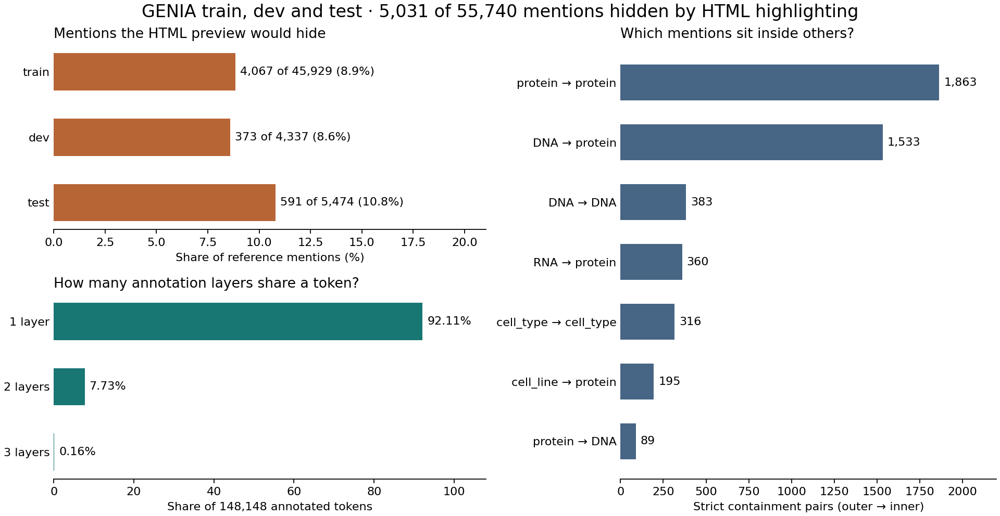

# Extraction workflows

This page separates a deterministic local check from an evaluation that can
support a deployment decision.

## Offline deterministic profile

Run the built-in profile without downloading a model or dataset:

```sh
cargo run -p anno-eval --example offline_extraction_profile
```

It compares `RegexNER`, `HeuristicNER`, and an explicit pattern-plus-heuristic stack on
`anno_eval::synthetic::news_dataset()`. The profile reports strict,
micro-averaged precision, recall, and F1: a prediction earns credit only when
both its character span and entity label exactly match a gold annotation.

It reports two latency values per backend:

- **first pass** includes the first traversal of the fixture and any lazy
  initialization it triggers;
- **warm pass average** is the mean of ten subsequent full-fixture passes on
  the same model instance.

The comparison is useful as a reproducible regression signal. It is not a
model benchmark or a production-quality claim: the fixture has eight short,
synthetic news examples and 23 authored annotations. Its labels and phrasing
are part of the repository, so they cannot establish performance on an unseen
or domain-specific corpus. Record the command, commit, host, Rust version, and
complete stdout with any result used for a decision.

The stack in this profile is constructed with explicit regex and heuristic
layers. It does not download or select an ML model. Test an ML-backed
stack separately and record the exact model artifact, configuration, runtime,
and whether every requested backend actually ran.

The `Offline extraction benchmark` GitHub Actions workflow runs the same
profile on a pinned WikiGold corpus. To repeat it locally, pass the downloaded
`wikigold.conll` file as the example's sole argument. For each gold mention the
profile checks whether either layer proposed its span and type and whether the
stack returned it. The four counts distinguish retained, lost, gained, and
missed mentions. The last line counts output surfaces that disagree with the
original text at their reported offsets.

## Caption playback links

A caption editor can use FCoref to suggest which earlier mention a pronoun refers to. The adapter returns the original cue IDs, character ranges, and playback times in milliseconds. [Run the caption example](../crates/anno/examples/caption_links/README.md)

## Migrating RDF relation labels

N-Triples, JSON-LD and graph N-Triples preserve letters, numbers, underscores
and hyphens in relation IRIs, and percent-encode other characters as UTF-8.
For example, `WORKS_AT` keeps `/rel/WORKS_AT`, `part:of` becomes
`/rel/part%3Aof`, and literal `part%3Aof` becomes `/rel/part%253Aof`.

Older releases replaced punctuation with underscores, so `part_of` and
`part:of` both used `/rel/part_of`. To migrate, re-export the original labeled
relations and update stored RDF and queries using those labels. If both labels
occurred, the old predicate alone cannot identify which original label a
particular edge used.

For a discontinuous mention all three RDF writers add a `vocab#sourceSegments`
literal. Its ordered, half-open Unicode character offsets use BRAT notation,
such as `2 5;10 13`. The start and end offsets still describe the envelope.
The dataset importer checks the segment bounds and preserves them in JSONL.
It also reads segments from Anno’s older v2 occurrence IRIs when the literal
is absent. Contiguous mentions need only the start and end offsets.

## Application workflow

For an application, instantiate one model, retain it for the process lifetime,
and preserve the returned character offsets with the source text. A compact
starting point is [the batch example](../crates/anno/examples/batch.rs): it
keeps one extractor instance and returns one result per input document.

For identified documents, `annotate_grounded_with` and
`annotate_grounded_batch_with` return `GroundedDocument` values, preserving
entity metadata and canonical grouping. Ungrouped entities get separate
singleton tracks. [The grounded example](../crates/anno/examples/grounded.rs)
demonstrates reuse of a local model. The CLI uses the signal-only conversion
`GroundedDocument::from_entity_signals`, leaving track creation to its explicit
coreference step.

`anno batch --batch-size 32` bounds each call to the backend's batch API.
`--parallel` bounds concurrent extraction chunks and subsequent enrichment workers.
Result caching is limited
to deterministic local backends; model-backed and coreference runs bypass it
until their effective artifact/configuration identity can be established.
Eligible cache keys also include a digest of the executable, so rebuilding the
same package version does not reuse results from different extraction code.

For stacked extraction, select a failure policy explicitly:

```rust
use anno::{StackedExtractionPolicy, StackedNER};

let model = StackedNER::builder()
    .layer(anno::RegexNER::new())
    .layer(anno::HeuristicNER::new())
    .build();
match model.extract_entities_with_report(
    "Grace Hopper developed COBOL.",
    None,
    StackedExtractionPolicy::Strict,
) {
    Ok(report) => println!("{} entities", report.entities().len()),
    Err(error) => {
        // Rejected runs retain the successful, failed, and skipped layer outcomes.
        eprintln!("{error}: {:?}", error.report().layer_outcomes());
    }
}
```

`BestEffort` permits partial results and exposes failures in the report. `Strict`
rejects a run if an attempted layer fails. Adaptive skips are recorded separately.
These outcomes describe inference on an already constructed stack; they are not
an artifact fingerprint or a record of model-construction fallback attempts.

Before using results for routing, redaction, or a knowledge graph, add a held
out set annotated to the application's label policy. Score exact span-and-label
P/R/F1 first, then inspect false positives and misses by entity type and source
format. Measure first and warm latency separately on representative document
lengths. If the workflow permits partial results, record which backends
succeeded and failed; otherwise make a failed backend a hard error.

The CLI fixture documents under `crates/anno-cli/tests/fixtures/` are useful
for regression assertions such as required mentions and minimum counts, but
they do not contain exhaustive gold annotations. Do not compute precision from
them.

## Review overlapping highlights

In the GENIA test file, “cyclophilin gene” is a DNA mention and “cyclophilin” inside it is a protein mention. Given both spans, the Rust function `anno::export::to_html` highlights the whole phrase once. It processes earlier starts first, prefers the longer span at a shared start, and skips later overlaps. A reviewer looking for the protein would miss a correct extraction.



Across the three published GENIA splits, that display rule would show **50,709 of 55,740 reference mentions** and hide **5,031 (9.0%)**. It hides 4,067 of 45,929 training mentions, 373 of 4,337 development mentions, and 591 of 5,474 test mentions. The original test-only replay shows 4,883 highlights. The most frequent nested pair also changes with scope. The test split has 190 protein mentions inside DNA mentions, its most frequent pair. Across all splits, protein inside protein leads with 1,863 pairs. When reviewing a suspected miss, inspect the original entity list or pass it to `anno::export::to_jsonl`, which writes one row per entity. Use those spans to calculate recall. [Export functions](../crates/anno/src/export.rs) · [Pinned split files and SHA-256 digests](eval/dataset-repo-files.csv) · [Reproduce the figures](../scripts/README.md#reproduce-the-dataset-figures)

## Comparing contract passage suggestions

Use the CUAD retrieval example's `matched_passages_per_question` field to
compare BM25 and literal category lookup at equal suggestion volume. For each
question both methods return as many windows as the shorter ranking. A hit
requires a window to contain the complete annotated answer. Each annotation
counts once even when windows overlap.
[Runnable example](../crates/anno-eval/examples/cuad_retrieval.rs) · [Pinned CUAD release](https://github.com/TheAtticusProject/cuad/tree/67faa0e6023b04fcaae6cc09497ab00e5d63a2a2)

Across Governing Law, Termination For Convenience and Non-Compete on the 102
test contracts, the unrestricted top-three lists recovered 100 answers with
867 BM25 windows and 43 with 136 literal windows. At equal volume, BM25
recovered 45 of 190 answers and literal lookup recovered 43, each in 136
windows. Summing across the three categories per contract, BM25 gained one
answer on six contracts and two on one, lost one on six and tied on 89.
An exact two-sided sign test on the 13 non-ties gave *p* = 1.00. This sample
provides little evidence that switching rankers improves recall at equal
volume. The counts measure machine suggestions. [Replay and category results](https://github.com/arclabs561/anno/pull/217)

## Carrying source revisions through brat and dataset JSONL

Keep one directory per source revision. From a common corpus root, export the
grounded document and import the resulting annotation file.

```sh
anno export --input v1/report.json --output v1/brat --format brat --include-confidence
anno dataset import --input v1/brat/report.ann --output v1/rows.jsonl --format brat --include-text
sha256sum v1/brat/report.txt
```

The companion `report.txt` contains the grounded document’s source text.
Keep the SHA-256 digest of those exact UTF-8 bytes with your document ID,
revision ID and annotation path in the corpus manifest. The digest distinguishes
text changes, including changes in Unicode normalization. Two documents can
contain the same text, and an annotation edit can leave the text digest unchanged.
Version the annotation file separately when tracking annotation edits.

Each imported row’s `source` records the annotation path supplied to the
importer. Running from the same root retains the revision directory in that
path. brat’s `T1`, `T2` identifiers are local to the annotation file.
The grounded document ID, signal IDs and local brat IDs are absent from these
JSONL rows. Use the manifest to recover document identity after moving files.

For a mention that skips intervening words, `segments` lists its half-open
Unicode character ranges. `start` and `end` bound the whole mention, and
`text` joins the selected pieces with spaces. Use the individual ranges when
repeated mentions have the same surface. Offsets count Unicode code points,
so a decomposed accent and its base character occupy two positions.

For one brat file, use an explicit original when checking an annotation before import.

```sh
anno dataset import --format brat --input reviewed.ann \
  --source-text editions/original.txt --output checked.jsonl
```

The importer checks supplied reference text and Unicode character ranges against
that document, including discontinuous annotations. An empty reference field
takes its surface from the document. For review of an exact edition, retain the
digests of both the document and the annotation file. A span can still match
after the surrounding passage or the annotation label changes.

## Verify mention JSONL against a source document

For one document and one entity per JSONL row, supply the exact UTF-8 text used
during extraction. The command checks every surface against its half-open
Unicode character offsets and preserves the supplied type label.

```sh
anno dataset import --format jsonl --input mentions.jsonl \
  --source-text post.txt --output checked.jsonl
```

JSONL export preserves discontinuous character ranges. Segmented rows may use space-joined pieces. When the gaps contain only line
breaks, the original multiline surface also passes. The row's `source` field
is an optional producer string. The optional `confidence` field accepts a number
or null. The importer validates mention rows against the file named by
`--source-text`. Additional row fields, including document IDs and hashes, are
ignored. A changed passage outside all mentions can still pass, so verify the
document ID and digest of the original bytes against your corpus manifest.

A successfully processed document with no predictions has an empty JSONL file.
Record its completion and zero mention count against the same ID and source
digest when scoring. A missing or failed run has no measured count.

## CoNLL offsets and the original source revision

By default, `anno dataset import --format conll` counts Unicode characters in
the token sequence reconstructed with one ASCII space between tokens. Blank
lines and `-DOCSTART-` reset entity boundaries without adding characters.
This convention retains offsets for existing token-only corpora.

When original document offsets matter, supply the matching UTF-8 text for a
single CoNLL file.

```sh
anno dataset import --format conll --input v1/report.conll \
  --source-text v1/report.txt --output v1/rows.jsonl
```

Every token, including tokens tagged `O`, must match the next source text
after any intervening Unicode whitespace. Adjacent tokens may touch in the
original. The importer checks the whole document and preserves tabs, multiple
spaces and line endings inside entities. The output ranges count Unicode
scalar values from the start of the original file, with an exclusive end.
CRLF counts as two characters. Keep the text revision and its digest alongside
the CoNLL file in the corpus manifest. The row’s `source` identifies the CoNLL file.

## Identifying RDF source documents

Provide the IRI of the exact source revision when exporting one file.

```sh
anno export --input report.txt --output rdf --format ntriples \
  --document-iri https://example.org/reports/42/revisions/3
```

N-Triples, JSON-LD and graph N-Triples share the same mention IDs. By default
the CLI hashes the canonical input path and extracted text to identify the
source revision. Moving a file or changing its text changes that identity.
An explicit versioned IRI lets different machines identify the same revision.

To migrate stored RDF from the earlier index-based IDs, re-export each original
document with its annotations in their original order using the earlier release
and this release. Within each document, use the index in each old mention ID
to find the original annotation and its new ID. Several annotations can have
the same type and outer span. A previously merged graph can contain several
occurrences under one old ID. Rebuild from the originals to recover them.
An external reference that recorded only the old ID can remain ambiguous.

## Trace a signal to its original HTML

`anno extract --file page.html --model pattern --html-source-spans` renders a
local UTF-8 HTML file with deformat's mapped strip renderer and writes grounded
JSON. Use `--export result.json` to save it. The renderer choice can change which
page content the model sees. For a fetched page, save the UTF-8 HTML you want to
identify and pass that file to `--file`. Its digest and offsets refer to the
saved bytes.

Use `anno query source-span result.json START END --original page.html` to project
a half-open character range in the analyzed text to the original file. This
also works when `--clean` or `--normalize` changes the rendered text. The
grounded `source_map` composes those steps. Preserve individual fragments
when inline markup interrupts a mention.

When the analyzed text still matches the mapped renderer output, the legacy
`html_source` also records SHA-256 digests of the source file and
rendered `text`. Match a signal's half-open character range to a `spans` entry's
`rendered_chars`. Discontinuous mentions have a separate entry for each component.
Each fragment identifies UTF-8 byte ranges in both the rendered text and the
original file. An inline tag can split one mention into several fragments.
`direct` means byte-for-byte correspondence. `entity_decoded` points to the
complete character reference, such as `&#64;`. `whitespace_collapsed`,
`synthetic`, and `unknown` identify an approximate origin, which can include
an entire text run or tag. For a gap in the renderer map, `unmapped` has a rendered byte
range and `null` source bytes. Check the source digest before using these byte ranges. Direct
fragments can be compared byte for byte with the rendered text.
