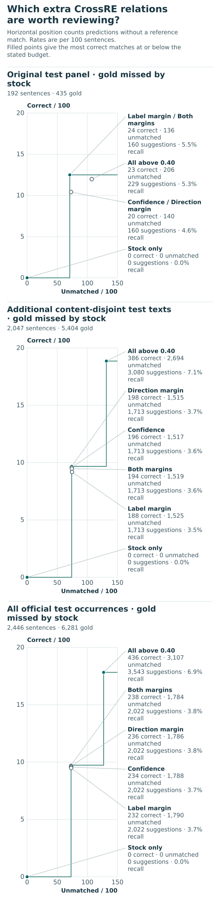
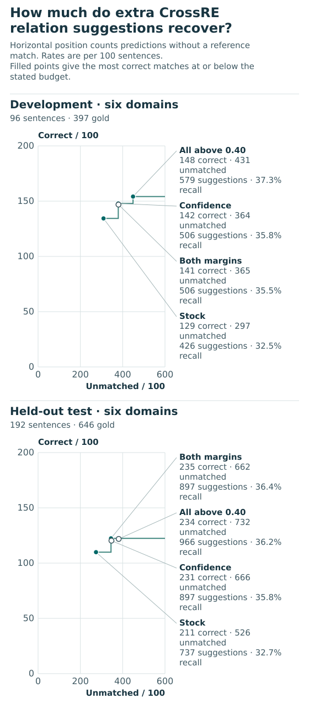

# Can competing predicate scores recover more CrossRE relations?

## Do the rules transfer to the remaining test sentences?

Keep the **0.50 gate for automatic extraction**. Across all 2,446 official test occurrences it matched 2,887 of 9,168 annotated relations in 10,405 predictions. Lowering the gate to 0.40 added 436 exact and 3,107 unmatched predictions. The additional edges were 12.3% exact. At the stock operating point they would need to exceed 14.75% exact to improve micro F1. Full-release F1 fell from **29.50% to 28.75%**. The gold, emitted and matched stock counts agreed with the earlier native ONNX run in every domain. [Complete counts and runtime comparison](crossre-full-test.json) · [Native stock run](crossre-full-prompt-comparison.md)

For a review queue, the original four-match advantage from combining label and direction margins **did not transfer**. On the 2,047 additional sentences, raw confidence recovered 196 relations in 1,713 suggestions. Both margins recovered 194 at the same budget. They changed 402 suggestions, gaining 53 matches and losing 55. Music gained nine net matches. The other five domains lost eleven in total. [Paired gains, losses and domain counts](crossre-full-test.json)

| Test population | Occurrences | Gold relations | Stock correct / emitted | Extra confidence correct / unmatched | Extra both-margins correct / unmatched | Extra above 0.40 correct / unmatched |
|---|---:|---:|---:|---:|---:|---:|
| Original balanced panel | 192 | 646 | 211 / 737 | 20 / 140 | 24 / 136 | 23 / 206 |
| Additional distinct texts | 2,047 | 7,895 | 2,491 / 9,041 | 196 / 1,517 | 194 / 1,519 | 386 / 2,694 |
| All eligible distinct texts | 2,239 | 8,541 | 2,702 / 9,778 | 216 / 1,657 | 218 / 1,655 | 409 / 2,900 |
| Outside the holdout | 207 | 627 | 185 / 627 | 18 / 131 | 20 / 129 | 27 / 207 |
| Complete official test release | 2,446 | 9,168 | 2,887 / 10,405 | 234 / 1,788 | 238 / 1,784 | 436 / 3,107 |

The next review rule should test whether to abstain when endpoint spans are uncertain. Among the 1,517 unmatched confidence suggestions on the additional holdout, **1,066 (70.3%)** used at least one span absent from the entity reference. Only 433 of the 1,713 sentences offering a candidate had an exact annotated edge anywhere in the permitted score band. That sets a ceiling of 433 recoveries for every one-per-sentence reranker over this pool. For a predicate-specific check, the strongest unannotated label above an annotated `role` was `win-defeat` on 176 low-scoring keys across retained and suppressed endpoints in this holdout. [Candidate ceiling, endpoint losses and label confusions](crossre-full-test.json)

The expansion keeps the rule chosen on the original 96 development sentences and the same model, prompts, thresholds and one-suggestion budget. The additional holdout comprises 2,047 distinct test texts with 7,895 reference relations. Adding the original 192 gives 2,239 eligible texts. The full-release comparison also includes the 207 occurrences outside the holdout. In exclusion order, five matched training text, 128 matched the earlier AI diagnostic set, 41 matched development text and 33 repeated an already selected test text. Each official occurrence is scored against its own annotations. [Source hashes, per-domain membership and excluded row indices](crossre-full-test.json)



The chart counts what a reviewer gains and has to inspect beyond the stock output. Its recall denominator is the number of reference relations stock missed on that cohort. The full release has 2,408 distinct space-joined sentence texts. Twenty-five appeared more than once, accounting for 63 occurrences. Six repeated texts had different directed relation references across their occurrences, considering the predicate, head and tail spans, and multiplicity. Each difference occurred within a domain. For two of the six texts, the stock match count changed with the reference. [Duplicate-text audit and cohort denominators](crossre-full-test.json)

Every score comes from the public PyTorch `predict_relations` call used to emit that sentence’s stock edges. The replay captures its one forward pass and reads the full directed predicate tensor before filtering. On the 192 original test rows, all 21,782 directed candidate rows, 334,422 predicate probabilities and the stock and review decisions were checked against Anno’s trained export. The largest absolute score difference was 1.49 × 10⁻⁸. [Full-test replay](../../scripts/qa/joint_baseline/relex_full_test.py) · [Balanced-study controls](crossre-predicate-ranking.json)

## What motivated the full test?

The initial 192-sentence test favored keeping GLiNER-Relex’s 0.50 predicate gate for automatic extraction. On this panel, the stock decoder matched 211 of 646 gold relations in 737 predictions. Lowering the gate to 0.40 recovered 23 more and added 206 unmatched outputs. Strict F1 fell from 30.5% to 29.0%. The earlier 32-sentence AI threshold trial had seen a 1.1-point gain. [Six-domain counts](crossre-predicate-ranking.json) · [Earlier AI trial](relex-role-trial.md#predicate-only-threshold-trial)

For a caller reviewing at most one extra suggestion per sentence, raw confidence recovered **20 relations for 140 unmatched suggestions**. It won the development tie-break. Adding the margins over both the competing predicate and the reverse direction recovered 24 for 136 unmatched on test. This rule changed 21 suggestions, gained five correct ones and lost one. It had recovered one fewer on development (12 versus 13). Its four net test gains came from music and politics. Both rules recovered zero from 24 news suggestions. [Aggregate and per-domain comparisons](crossre-predicate-ranking.json)



## Where does the model lose the relation?

The 192 test sentences contain **288 distinct annotated relations** whose exact endpoints survived mention decoding but whose relation score fell at or below 0.50. In 145 cases a stronger unannotated predicate won on the same directed pair. In 16 more, only another valid predicate scored higher. The reverse direction scored higher on 41 cases, including 36 that also had a stronger wrong label. [Rank counts and predicate confusions](crossre-predicate-ranking.json)

| Low-scoring annotated relations | Keys | Ranked first | Only other valid labels ahead | Unannotated label ahead | Same predicate higher in unannotated reverse |
|---|---:|---:|---:|---:|---:|
| Original 32 AI sentences, retained or suppressed endpoints | 62 | 23 | 0 | 39 | 4 |
| Fresh test, both endpoints retained | 288 | 127 | 16 | 145 | 41 |
| Fresh test, at least one endpoint suppressed | 58 | 36 | 2 | 20 | 3 |

The first three rank columns partition the keys. The direction column can overlap them. All these keys had reverse scores and none tied for first. Across the 603 distinct directed pairs in the test reference, 43 had multiple valid predicates. Nine pairs were annotated in both directions, each with different predicates.

Only **53 of the 288** low-scoring retained gold relations entered the `(0.30, 0.50]` suggestion pool. They appeared in **36 of the 160** sentences that offered a suggestion. Even a reviewer with the answer key could recover at most 36 relations at one per sentence. Among confidence’s 140 unmatched outputs, 86 used at least one span missing from the entity annotations. A further 32 joined two annotated entities with no reference relation in either direction. The other 22 selected a different predicate or direction on a linked pair.

The next development trial should rank or withhold suggestions using the two endpoint mention scores. Compare that rule with confidence and label margins at equal review volume, then measure how many exact relations it retains on unused test sentences. This tests whether Anno can spare reviewers the largest observed class of unmatched suggestions.

## What was scored

The replay read all 18 pinned English CrossRE files. Each domain’s training split supplied its entity and predicate prompts. We selected 16 development and 32 test sentences per domain by ascending SHA-256 of the space-joined UTF-8 sentence. Selection excluded training texts, the first 128 AI test texts from earlier diagnostics and previously selected texts. Test also excluded every development text. The historical replay added AI test indices 64–95. In all, the model scored 320 inputs. The new panels cover 96 of 2,151 development sentences and 192 of 2,446 test sentences, including 47 test sentences without a gold relation. They contain 397 of 8,199 development and 646 of 9,168 test relation occurrences. Full-release measurements are available for the stock decoder. [Input identities and panel digests](crossre-predicate-ranking.json) · [Full-test stock results](crossre-full-prompt-comparison.md)

The upstream PyTorch `predict_relations` and Anno’s trained export module produced the same stock directed edge multiset for all 320 sentences. Exact matching uses both character spans and the predicate in the annotated direction, preserving duplicate reference occurrences. Ranking counts distinct keys and records their multiplicity. All 646 held-out occurrences had distinct keys. An unmatched prediction disagrees with the published annotations, which may omit valid relations. [Checkpoint revision](https://huggingface.co/knowledgator/gliner-relex-large-v1.0/tree/4aedc9226a5ac9e2f6b5ea3e91c1ee577c88a290) · [Export module](../../scripts/export_gliner_relex_joint.py)

All review rules keep stock outputs and choose at most one extra on retained endpoints. The four rankings used raw confidence, confidence plus half its lead over the strongest other prompted label, confidence plus half its lead over the same label in reverse, or both terms. Missing reverse scores contribute zero margin. Ties use raw confidence then lexical edge order. Development selected the most exact additions, breaking ties in favor of the simpler rule before evaluating fresh test predictions. The 0.40 comparison returns every retained-pair predicate above that gate. [Replay and scoring code](../../scripts/qa/joint_baseline/relex_predicate_ranking.py)

## Reproduce

Set `CROSSRE` to the directory with the 18 pinned publisher files and `RELEX` to the local model snapshot above. The replay uses `gliner==0.2.30` and verifies source, weight and tokenizer hashes. The renderer reads the aggregate chart specification offline. [Pinned CrossRE files and terms](https://github.com/mainlp/CrossRE/tree/a58885fa760559d2dc9e176e730fe731f020d6f3) · [Portable chart specification](crossre-predicate-tradeoff.json)

```sh
trial=$(mktemp -d)
python scripts/qa/joint_baseline/relex_predicate_ranking.py "$CROSSRE" "$RELEX" \
  --output "$trial/crossre-predicate-ranking.json" \
  --tradeoff-output "$trial/crossre-predicate-tradeoff.json"
anno viz tradeoff "$trial/crossre-predicate-tradeoff.json" -o "$trial/crossre-predicate-tradeoff.svg"
```

To reproduce the complete test release with the original development choice, run the single-forward collector and summarize the completed rows. The local cache can resume interrupted runs. The committed aggregate and chart input contain counts and fingerprints. [Full-test measurements](crossre-full-test.json) · [Full-test chart input](crossre-full-test-tradeoff.json)

```sh
trial=$(mktemp -d)
python scripts/qa/joint_baseline/relex_full_test.py collect "$CROSSRE" "$RELEX" "$trial/rows"
python scripts/qa/joint_baseline/relex_full_test.py summarize "$CROSSRE" "$trial/rows" \
  --output "$trial/full.json" --tradeoff-output "$trial/full-tradeoff.json"
anno viz tradeoff "$trial/full-tradeoff.json" -o "$trial/full.svg"
```

For a separate development reranking study, the balanced runner's `--all-eligible` option expands training-disjoint development to 2,121 unique texts and includes the eligible 2,239 test texts plus the historical 32.
