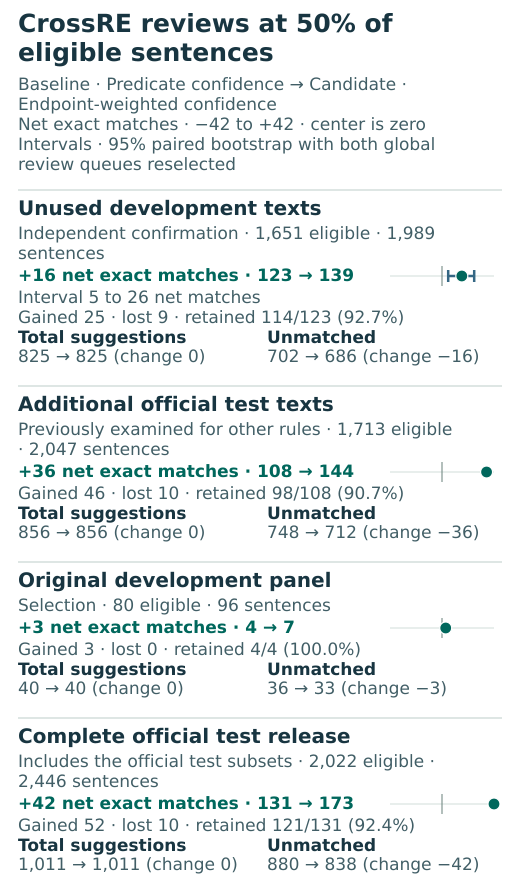
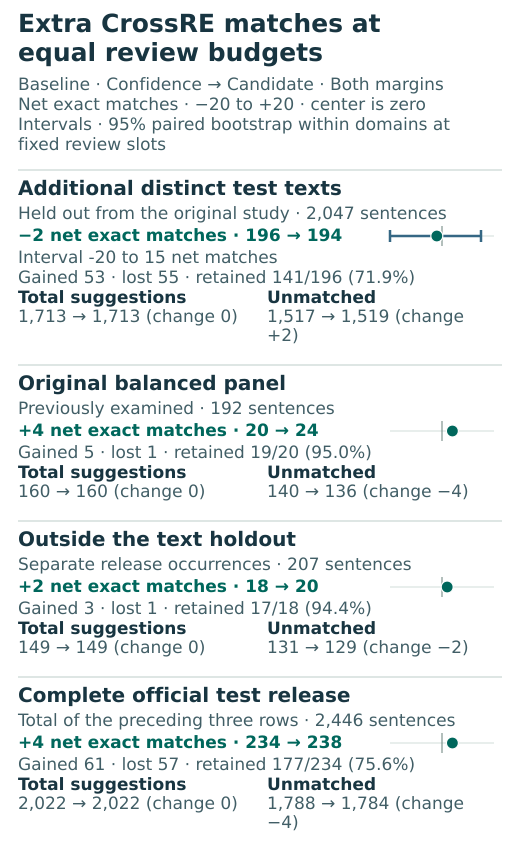
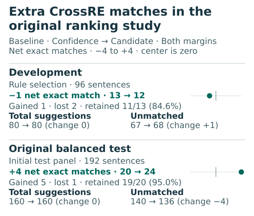

# Which CrossRE relation suggestions are worth reviewing?

## Does the model’s confidence in its endpoints improve a fixed review queue?

**Use endpoint-weighted confidence for a CrossRE review queue with room for half the eligible sentences.** Rank by predicate confidence times the square root of the weaker endpoint’s mention score. On 1,989 unused development texts, 1,651 sentences offered an eligible edge. In exactly **825 reviews**, the frozen rule recovered **139** reference relations against **123** for predicate confidence alone. That is **16 more exact matches**, or **1.94 more per 100 reviews**. The 95% paired interval was **+5 to +26 matches** (+0.61 to +3.15 per 100). Precision rose from 14.9% to 16.8%. Those 139 recoveries covered 2.78% of the 4,996 relations missed by stock. The queue still contained 686 unmatched suggestions. Keep an explicit human review step. [Independent confirmation counts, domain allocations and interval](crossre-endpoint-budget.json)



| Share of eligible confirmation texts | Reviews per rule | Exact with predicate confidence | Exact with endpoint weighting | Correct relations gained / lost | Unmatched with an inexact endpoint, confidence → weighted |
|---|---:|---:|---:|---:|---:|
| 25% | 412 | 68 | 77 | 26 / 17 | 221 → 177 |
| **50% (primary)** | **825** | **123** | **139** | **25 / 9** | **463 → 403** |
| 100% | 1,651 | 198 | 212 | 21 / 7 | 968 → 921 |

The first 412 endpoint-weighted reviews yielded 77 matches (18.7%). The next 413 yielded 62 (15.0%). Expanding beyond the primary budget required another 826 reviews for 73 matches (8.8%). [Nested review budgets](crossre-endpoint-budget.json)

The previously examined official test data supported the same decision. On the 2,047 additional texts, the weighted rule changed **108 to 144 exact** in the same **856 slots**, gaining 46 correct relations and losing ten. Unmatched suggestions fell from 748 to 712. On all 2,446 official occurrences together, the result was **131 to 173 exact** in **1,011 slots**, with **52 gained and ten lost**. Unmatched suggestions fell from 880 to 838. The official population includes those 2,047 texts. Its results complement the independent development confirmation. [All test subsets and review costs](crossre-endpoint-budget.json) · [Four-population paired chart](crossre-endpoint-paired.json)

At the primary budget the rules kept the same edge in 676 slots. The weighted queue admitted 85 different sentences and changed the edge on 64 sentences both rules reviewed. It gained 25 correct identities and lost nine, including two sentences where each selected a different correct relation. Suggestions using a span absent from the entity reference fell by 60. Unmatched suggestions whose two spans were annotated rose by 44, from 239 to 283. For those 283 edges, the selected entity pair, predicate or direction still disagreed with the reference. Cross-domain allocation also changed. Politics went from 30 exact in 177 slots to 38 in 186. Literature went from 26 in 175 to 24 in 173. [Queue membership and paired identity counts](crossre-endpoint-budget.json)

For an Anno batch-review feature, keep both endpoint scores with each below-stock predicate candidate and rank the batch before displaying suggestions. A stream that admits suggestions independently on each request would need a separately calibrated admission threshold. The next comparison should keep endpoint weighting fixed and test whether a pair of recognized entities actually supports the suggested predicate, using fresh text for confirmation. [Model outputs and scoring contract](../../scripts/qa/joint_baseline/relex_endpoint_budget.py)

The endpoint audit motivated a rule Anno can apply during inference. Keep the stock entity and adjacency gates at 0.50. For each extra candidate with predicate confidence in `(0.30, 0.50]`, multiply its predicate confidence by the smaller of its two predicted mention confidences raised to a weight. A weaker mention can move an edge down the queue or change which edge its sentence nominates. Each sentence nominates at most one edge. All six domains then compete for the same fixed number of review slots. Raw predicate confidence uses weight zero. Ties use raw confidence, then directed edge order within a sentence or text hash and source location between sentences. [Inference, queue construction and exact matching](../../scripts/qa/joint_baseline/relex_endpoint_budget.py)

Eighty of the original 96 development sentences nominated an eligible edge. At the predeclared 50% budget, raw confidence recovered 4 exact relations in 40 slots. Weights 0.5 and 1 each recovered 7, and weight 2 recovered 6. The tie rule selected the smaller positive weight, **0.5**, before measuring confirmation. The 25% and 100% budgets test sensitivity to queue size. All three compare endpoint weighting with raw predicate confidence, keep the same fitted weight and round the slot count down. The earlier predicate-margin study filled the entire eligible queue. Gold spans and relations enter only when scoring the choices. [Pinned calibration and per-budget measurements](crossre-endpoint-budget.json)

Of the 2,151 development occurrences, 96 were used for selection and **1,989 additional distinct texts** for independent confirmation. For the remaining 66, three matched training text, 38 matched official test text and 25 repeated a development text already represented, applying those exclusions in that order. The confirmation texts share no space-joined text with training, calibration or any official test occurrence. The 668 training rows supplied label prompts and the overlap check. [Cohort selection and source verification](../../scripts/qa/joint_baseline/relex_endpoint_budget.py) · [Publisher release](https://github.com/mainlp/CrossRE/tree/a58885fa760559d2dc9e176e730fe731f020d6f3)

The official test release was examined to motivate the endpoint rule. Its 2,047 additional texts, 192 original occurrences and 207 outside the content holdout partition the 2,446 official occurrences. Ranked separately at 50%, the three weighted queues found 144, 12 and 13 exact relations in 856, 80 and 74 slots. That gives 169 matches in 1,010 reviews. Ranking the whole release together admitted 1,011 reviews and found 173 matches. Across development and test, the study scores **4,531 release occurrences representing 4,493 distinct texts**. The coverage counts calibration once. [Per-population denominators](crossre-endpoint-budget.json) · [Official duplicate-text audit](crossre-full-test.json)

The primary paired interval uses 10,000 bootstrap draws of eligible confirmation sentences, with replacement within each domain at its observed eligible count. Each draw is shared by both rules. Both reselect their globally ranked top suggestions and refill the original number of slots before computing the difference in exact matches. The 2.5th and 97.5th empirical percentiles measure sensitivity to sampling sentences from this six-domain mix. They condition on the frozen weight and the observed eligible count in each domain. [Standalone HTML report](../figures/crossre-endpoint-paired.html) · [Bootstrap implementation](../../scripts/qa/joint_baseline/relex_endpoint_budget.py) · [Paired figure input](crossre-endpoint-paired.json)

## Which predicate gate should Anno use for automatic extraction?

Reject the **0.40 gate as the CrossRE default for automatic extraction**. Keep the stock 0.50 gate. Across all 2,446 official test occurrences the stock decoder matched 2,887 of 9,168 annotated relations in 10,405 predictions. Lowering the gate to 0.40 added 436 exact and 3,107 unmatched predictions. The additional edges were 12.3% exact. At the stock operating point they would need to exceed 14.75% exact to improve micro F1. Full-release F1 fell from **29.50% to 28.75%**. News lost 3.59 F1 points. Politics gained 0.72 and science gained 0.21. The gold, emitted and matched stock counts agreed with the earlier native ONNX run in every domain. [Complete counts and runtime comparison](crossre-full-test.json) · [Native stock run](crossre-full-prompt-comparison.md)

The **full-release** comparison tested automatic extraction at 0.50 and 0.40. The general `anno extract` command defaults its relation threshold to **0.55** when both threshold flags are omitted. A retrospective replay compared that gate on the original 96 development and 192 test sentences, holding CrossRE’s training-derived prompts and mention selection fixed. On development, 0.55 matched 121 of 397 references in 371 predictions (31.51% F1), compared with 31.35% at 0.50. On the original test panel, 0.55 matched 200 of 646 in 628 predictions (31.40% F1), compared with 211 in 737 (30.51% F1) at 0.50. This smaller check gives no reason to lower Anno’s general CLI default. Its full-release performance at 0.55 remains unmeasured. [CLI threshold semantics](../../crates/anno-cli/src/cli/commands/extract.rs) · [Retrospective counts and sample fingerprints](crossre-cli-predicate-gates.json)

## Do the rules transfer to the remaining test sentences?

For a review queue, **keep raw confidence as the baseline**. On 2,047 additional distinct test texts, confidence recovered 196 relations in 1,713 extra suggestions. Combining the label and direction margins recovered 194 in the same 1,713 slots. It changed 402 suggestions, gaining 53 correct relation identities and losing 55. On 14 sentences both rules selected a different correct relation. At the sentence level, 39 slots became correct and 41 became incorrect. Music gained nine net matches. The other five domains lost eleven in total. [Paired gains, losses and per-domain transitions](crossre-full-test.json)



The additional-text difference is **−2 matches**, or −0.12 per 100 review slots. Its 95% paired bootstrap interval is **−20 to +15 matches** (−1.17 to +0.88 per 100). The calculation resamples the suggested sentences within each of the six domains at its observed slot count. The 14 sentences where both rules chose different correct relations contribute zero net matches to each paired draw. The interval measures sensitivity to the sampled sentences within this domain mix. The release counts themselves are exact. [Standalone HTML report](../figures/crossre-full-test-paired.html) · [Paired figure input](crossre-full-test-paired.json) · [Interval calculation](../../scripts/qa/joint_baseline/relex_full_test.py)

| Additional test domain | Slots per rule | Exact with confidence | Exact with both margins | Net matches | Domain 95% interval |
|---|---:|---:|---:|---:|---:|
| AI | 187 | 24 | 22 | −2 | −8 to +3 |
| Literature | 357 | 36 | 35 | −1 | −10 to +8 |
| Music | 306 | 33 | 42 | +9 | +1 to +18 |
| News | 255 | 7 | 4 | −3 | −7 to 0 |
| Politics | 325 | 51 | 48 | −3 | −11 to +4 |
| Science | 283 | 45 | 43 | −2 | −10 to +6 |

Music is worth investigating on a separate sample. Its interval widens from **+1 to +18** to **−2 to +21** when allowing for the six domains inspected, using a Bonferroni adjustment. All six adjusted intervals include zero. These data give little reason to add a music-specific margin rule to Anno. [Paired sentence outcomes and both intervals for every domain](crossre-full-test.json)

| Test population | Occurrences | Gold relations | Stock correct / emitted | Extra confidence correct / unmatched | Extra both-margins correct / unmatched | Extra above 0.40 correct / unmatched |
|---|---:|---:|---:|---:|---:|---:|
| Additional distinct texts | 2,047 | 7,895 | 2,491 / 9,041 | 196 / 1,517 | 194 / 1,519 | 386 / 2,694 |
| Original balanced panel | 192 | 646 | 211 / 737 | 20 / 140 | 24 / 136 | 23 / 206 |
| Outside the holdout | 207 | 627 | 185 / 627 | 18 / 131 | 20 / 129 | 27 / 207 |
| Complete official test release | 2,446 | 9,168 | 2,887 / 10,405 | 234 / 1,788 | 238 / 1,784 | 436 / 3,107 |

Among the 1,517 unmatched confidence suggestions on the additional holdout, **1,066 (70.3%)** used at least one span absent from the entity reference. Only 433 of the 1,713 sentences offering a candidate had an exact annotated edge anywhere in the permitted score band. Even a perfect one-per-sentence ranking could recover only **433 of the 5,404 stock misses (8.0%)**. To improve recall substantially, work on the scores feeding the queue. Of the 3,846 missed reference relations whose endpoints survived and whose predicate scored at or below 0.50, just 726 reached the review band. The strongest unannotated label above an annotated `role` was `win-defeat` on 176 low-scoring keys across retained and suppressed endpoints. That recurring confusion makes a concrete regression target for directed predicate scoring. [Candidate ceiling, endpoint losses and label confusions](crossre-full-test.json)

One cheap endpoint signal is whether stock already emitted a different predicate on the same directed span pair. Among the 1,713 confidence suggestions on the additional texts, **39 of 349 (11.2%)** with that support matched their reference. **157 of 1,364 (11.5%)** matched on the remaining span pairs. This cue alone offered little separation. The count of 1,066 missing reference endpoints requires gold annotations and is available only when evaluating a finished extraction. [Confidence suggestions grouped by stock pair support](crossre-full-test.json)

The expansion keeps the rule chosen on the original 96 development sentences and the same model, prompts, thresholds and one-suggestion budget. The additional holdout comprises 2,047 distinct test texts with 7,895 reference relations. Adding the original 192 gives 2,239 eligible texts. The full-release comparison also includes the 207 occurrences outside the holdout. In exclusion order, five matched training text, 128 matched the earlier AI diagnostic set, 41 matched development text and 33 repeated an already selected test text. Each official occurrence is scored against its own annotations. [Source hashes, per-domain membership and excluded row indices](crossre-full-test.json)

The paired chart counts **only suggestions added to stock**. On the additional texts, stock missed 5,404 of 7,895 reference occurrences. Confidence recovered 196 of those 5,404 (3.63%). On the complete official release it recovered 234 of 6,281 stock misses (3.73%). The release contains 2,408 distinct space-joined sentence texts. Twenty-five appeared more than once, accounting for 63 occurrences. Six repeated texts had different directed relation references across their occurrences, considering the predicate, head and tail spans, and multiplicity. Each difference occurred within a domain. For two of the six texts, the stock match count changed with the reference. [Duplicate-text audit and cohort denominators](crossre-full-test.json) · [All examined operating points](crossre-full-test-tradeoff.json)

Every score comes from the public PyTorch `predict_relations` call used to emit that sentence’s stock edges. The replay captures its one forward pass and reads the full directed predicate tensor before filtering. On the 192 original test rows, all 21,782 directed candidate rows, 334,422 predicate probabilities and the stock and review decisions were checked against Anno’s trained export. The largest absolute score difference was 1.49 × 10⁻⁸. [Full-test replay](../../scripts/qa/joint_baseline/relex_full_test.py) · [Balanced-study controls](crossre-predicate-ranking.json)

## What motivated the full test?

The initial 192-sentence test favored keeping GLiNER-Relex’s 0.50 predicate gate for automatic extraction. On this panel, the stock decoder matched 211 of 646 gold relations in 737 predictions. Lowering the gate to 0.40 recovered 23 more and added 206 unmatched outputs. Strict F1 fell from 30.5% to 29.0%. The earlier 32-sentence AI threshold trial had seen a 1.1-point gain. [Six-domain counts](crossre-predicate-ranking.json) · [Earlier AI trial](relex-role-trial.md#predicate-only-threshold-trial)

For a caller reviewing at most one extra suggestion per sentence, raw confidence recovered **20 relations for 140 unmatched suggestions**. It won the development tie-break. Adding the margins over both the competing predicate and the reverse direction recovered 24 for 136 unmatched on test. This rule changed 21 suggestions, gained five correct ones and lost one. It had recovered one fewer on development (12 versus 13). Its four net test gains came from music and politics. Both rules recovered zero from 24 news suggestions. [Aggregate and per-domain comparisons](crossre-predicate-ranking.json)



## Where does the model lose the relation?

The 192 test sentences contain **288 distinct annotated relations** whose exact endpoints survived mention decoding but whose relation score fell at or below 0.50. In 145 cases a stronger unannotated predicate won on the same directed pair. In 16 more, only another valid predicate scored higher. The reverse direction scored higher on 41 cases, including 36 that also had a stronger wrong label. [Rank counts and predicate confusions](crossre-predicate-ranking.json)

| Low-scoring annotated relations | Keys | Ranked first | Only other valid labels ahead | Unannotated label ahead | Same predicate higher in unannotated reverse |
|---|---:|---:|---:|---:|---:|
| Original 32 AI sentences, retained or suppressed endpoints | 62 | 23 | 0 | 39 | 4 |
| Original 192 test sentences, both endpoints retained | 288 | 127 | 16 | 145 | 41 |
| Original 192 test sentences, at least one endpoint suppressed | 58 | 36 | 2 | 20 | 3 |

The first three rank columns partition the keys. The direction column can overlap them. All these keys had reverse scores and none tied for first. Across the 603 distinct directed pairs in the test reference, 43 had multiple valid predicates. Nine pairs were annotated in both directions, each with different predicates.

Only **53 of the 288** low-scoring retained gold relations entered the `(0.30, 0.50]` suggestion pool. They appeared in **36 of the 160** sentences that offered a suggestion. Even a reviewer with the answer key could recover at most 36 relations at one per sentence. Among confidence’s 140 unmatched outputs, 86 used at least one span missing from the entity annotations. A further 32 joined two annotated entities with no reference relation in either direction. The other 22 selected a different predicate or direction on a linked pair.

## What was scored

The replay read all 18 pinned English CrossRE files. Each domain’s training split supplied its entity and predicate prompts. We selected 16 development and 32 test sentences per domain by ascending SHA-256 of the space-joined UTF-8 sentence. Selection excluded training texts, the first 128 AI test texts from earlier diagnostics and previously selected texts. Test also excluded every development text. The historical replay added AI test indices 64–95. In all, the model scored 320 inputs. The original ranking panels cover 96 of 2,151 development sentences and 192 of 2,446 test sentences, including 47 test sentences without a gold relation. They contain 397 of 8,199 development and 646 of 9,168 test relation occurrences. Full-release measurements are available for the stock decoder. [Input identities and panel digests](crossre-predicate-ranking.json) · [Full-test stock results](crossre-full-prompt-comparison.md)

The upstream PyTorch `predict_relations` and Anno’s trained export module produced the same stock directed edge multiset for all 320 sentences. Exact matching uses both character spans and the predicate in the annotated direction, preserving duplicate reference occurrences. Ranking counts distinct keys and records their multiplicity. All 646 held-out occurrences had distinct keys. An unmatched prediction disagrees with the published annotations, which may omit valid relations. [Checkpoint revision](https://huggingface.co/knowledgator/gliner-relex-large-v1.0/tree/4aedc9226a5ac9e2f6b5ea3e91c1ee577c88a290) · [Export module](../../scripts/export_gliner_relex_joint.py)

All review rules keep stock outputs and choose at most one extra on retained endpoints. The four rankings used raw confidence, confidence plus half its lead over the strongest other prompted label, confidence plus half its lead over the same label in reverse, or both terms. Missing reverse scores contribute zero margin. Ties use raw confidence then lexical edge order. Development selected the most exact additions, breaking ties in favor of the simpler rule before evaluating fresh test predictions. The 0.40 comparison returns every retained-pair predicate above that gate. [Replay and scoring code](../../scripts/qa/joint_baseline/relex_predicate_ranking.py)

## Reproduce

All three paired figures can be rebuilt solely from the published aggregate counts. Run these commands from the checkout root. [Offline generator](../../scripts/qa/joint_baseline/relex_paired_figures.py) · [Original paired chart input](crossre-predicate-paired.json)

```sh
trial=$(mktemp -d)
python3 scripts/qa/joint_baseline/relex_paired_figures.py --include-endpoint --output "$trial"
anno viz paired "$trial/crossre-predicate-paired.json" -o "$trial/original.svg"
anno viz paired "$trial/crossre-full-test-paired.json" -o "$trial/full.svg"
anno viz paired "$trial/crossre-endpoint-paired.json" -o "$trial/endpoint.svg"
```

To rerun inference, set `CROSSRE` to the directory with the 18 pinned publisher files and `RELEX` to the local model snapshot above. The collectors use `gliner==0.2.30` and verify source, weight and tokenizer hashes. The balanced collector reruns the original measurements and absolute operating-point analysis. [Pinned CrossRE files and terms](https://github.com/mainlp/CrossRE/tree/a58885fa760559d2dc9e176e730fe731f020d6f3)

```sh
trial=$(mktemp -d)
python scripts/qa/joint_baseline/relex_predicate_ranking.py "$CROSSRE" "$RELEX" \
  --output "$trial/crossre-predicate-ranking.json" \
  --tradeoff-output "$trial/crossre-predicate-tradeoff.json" \
  --cli-gate-output "$trial/crossre-cli-predicate-gates.json"
anno viz tradeoff "$trial/crossre-predicate-tradeoff.json" -o "$trial/crossre-predicate-tradeoff.svg"
```

To reproduce the complete test release with the original development choice, run the single-forward collector and summarize the completed rows. The local cache can resume interrupted runs. The committed aggregate and chart input contain counts and fingerprints. [Full-test measurements](crossre-full-test.json) · [Full-test paired chart input](crossre-full-test-paired.json)

```sh
trial=$(mktemp -d)
python scripts/qa/joint_baseline/relex_full_test.py collect "$CROSSRE" "$RELEX" "$trial/rows"
python scripts/qa/joint_baseline/relex_full_test.py summarize "$CROSSRE" "$trial/rows" \
  --output "$trial/full.json" --tradeoff-output "$trial/full-tradeoff.json"
anno viz tradeoff "$trial/full-tradeoff.json" -o "$trial/full.svg"
```

For a separate development reranking study, the balanced runner's `--all-eligible` option expands training-disjoint development to 2,121 unique texts and includes the eligible 2,239 test texts plus the historical 32.

The **Held-out native relation extraction** workflow reruns the endpoint experiment with `endpoint_budget=true`. CI run 46090755050 independently reproduced the same frozen calibration on two runners, measured the unused development cohort and complete official test release, and reconciled the results. Its `crossre-endpoint-study` artifact contains the aggregate measurements and original chart input for 30 days. Sentence text, predicted edges and per-sentence scores stay on each runner. [Completed CI measurement](https://github.com/arclabs561/anno/actions/runs/46090755050) · [Aggregate build artifact](https://github.com/arclabs561/anno/actions/runs/46090755050/artifacts/15242766142) · [Workflow](../../.github/workflows/relex-crossre.yml)

The checked-in aggregate is byte-identical to the artifact. The published chart names the 50% rule in its title and adds each eligible-sentence denominator to its row label. The `--include-endpoint` command above regenerates the labels from this aggregate. The commands below reproduce both measurements using one local prediction cache. [Offline generator](../../scripts/qa/joint_baseline/relex_paired_figures.py) · [Published chart input](crossre-endpoint-paired.json) · [Endpoint collector](../../scripts/qa/joint_baseline/relex_endpoint_budget.py)

```sh
trial=$(mktemp -d)
study=scripts/qa/joint_baseline/relex_endpoint_budget.py
python "$study" collect "$CROSSRE" "$RELEX" "$trial/rows" --scope calibration
python "$study" select "$CROSSRE" "$trial/rows" "$trial/selection.json"
for part in confirmation test; do
  python "$study" collect "$CROSSRE" "$RELEX" "$trial/rows" --scope "$part"
  python "$study" measure "$CROSSRE" "$trial/rows" "$trial/selection.json" \
    --part "$part" --output "$trial/$part.json"
done
python "$study" assemble "$trial/confirmation.json" "$trial/test.json" \
  --output "$trial/crossre-endpoint-budget.json" --paired-output "$trial/crossre-endpoint-paired.json"
anno viz paired "$trial/crossre-endpoint-paired.json" -o "$trial/endpoint.svg"
```
