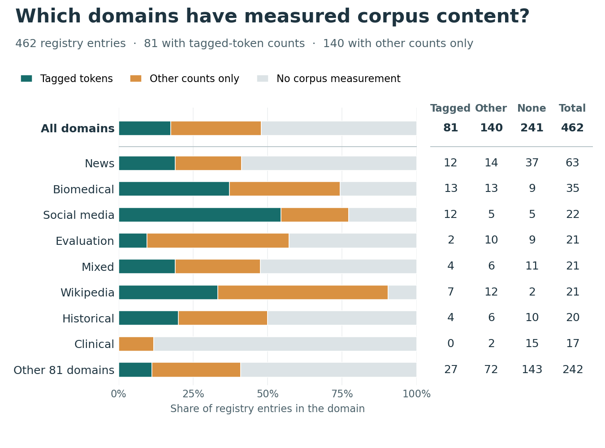
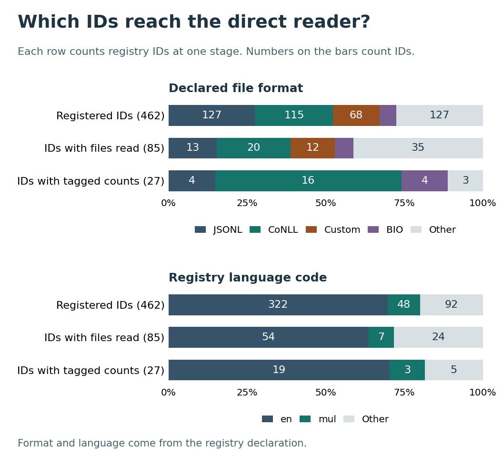
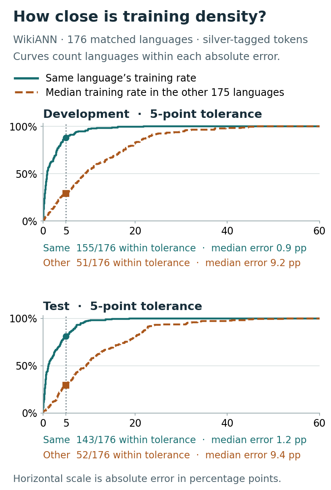
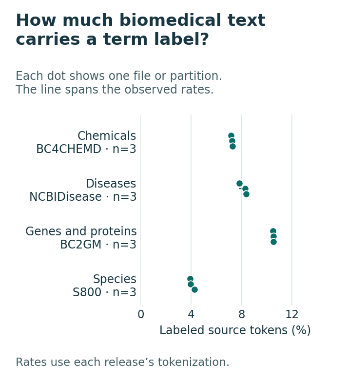
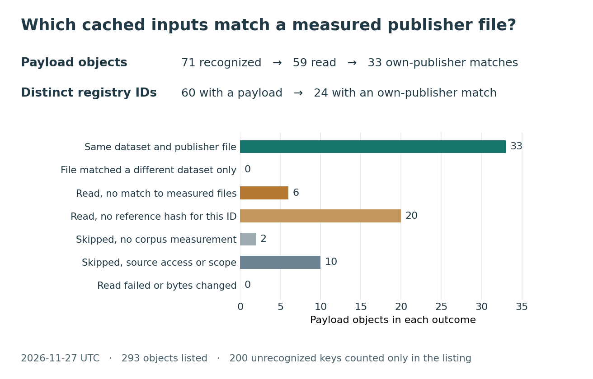

# Which datasets do the figures cover?

<!-- coverage-overview -->

The survey accounts for all **462 registry IDs**. It measured corpus content for **221**, including **81** with a tagged-token numerator and denominator. The other **140** have counts such as documents, words, questions or annotation offsets. **241** have no independent content measurement. The registry URL check is dated 2026-11-27. A source row identifies the edition, split, annotation layer or sample actually read. [All IDs, source scopes and exclusions](dataset-coverage.csv) · [Registry definitions](../../crates/anno-eval/src/eval/dataset_registry.rs)

<!-- /coverage-overview -->



<!-- coverage-domains -->

The readers measured 26 of 63 news entries, 26 of 35 biomedical entries and 19 of 21 Wikipedia entries. Clinical coverage is **2 of 17**, including 0 with a verified token-label denominator. The chart shows the eight largest domains. The domain table includes all 89 registry labels. Open the explorer, choose a domain and select a scored outcome to see the backend and split. [Dataset explorer](dataset-explorer.html) · [Counts by domain](dataset-coverage-by-domain.csv) · [Source terms and measured layers for every clinical entry](dataset-clinical-access.csv)

<!-- /coverage-domains -->

## Which datasets have a scored backend and split?

<!-- coverage-evaluations -->

**18 of 462 registry IDs have a completed score in these sources**. 12 of those IDs also have tagged-token counts. 432 IDs have no outcome in the indexed sources. The remaining IDs have a loader rejection, backend failure or exporter replay only. [Search by domain, backend and split](dataset-explorer.html) · [All outcomes with source receipts](dataset-evaluation-coverage.csv)

On **2026-11-27 UTC**, `ci.yml` recorded 18 push runs on `main`. 16 succeeded and 2 were cancelled. The 32 sanity and matrix archives contain 240 scored attempts, 16 failed evaluations, 80 named loader selections and 62 named pre-scoring load rejections. The scored attempts reported 32 from S3 cache, 208 from local cache. A local read can follow an S3 staging step. A same-ID publisher-file digest identifies the input split or release for 92 scored attempts. 48 used named checkout fixtures and 100 had no established split. The same examples can recur across pushes. [Run and artifact digests](dataset-ci-survey.json) · [Normalized CI records](dataset-ci-outcomes.csv)

<!-- /coverage-evaluations -->

Download `dataset-explorer.html` and open it locally. Start with a domain, a measured annotation unit and the **Scored** outcome. Expand an ID to see its declared tasks, the actual scoring task, backend, split, input count and receipt. An independent corpus count describes the annotations available for inspection. A completed run uses the specific population in its receipt. Source-defined labels can be manual, silver, mixed or scoped to one annotation layer. [Download the standalone explorer](https://raw.githubusercontent.com/arclabs561/anno/main/docs/eval/dataset-explorer.html) · [Plain CSV](dataset-evaluation-coverage.csv)

OntoNotesSample illustrates why the ID and input both matter. Its six scored CI attempts and ten CoNLL2003Sample attempts used five examples apiece from the same cached bytes, SHA-256 prefix `0632f32c090e`. Their registry names alone cannot establish independent test corpora. WikiGold supplies a positive control. Its 32 S3-backed sanity scores each used 20 sentences from the publisher-matched release, and ten local-cache matrix trials each used five examples from those same bytes. [Sample sizes, read routes and input hashes](dataset-ci-outcomes.csv) · [Publisher-file matches](s3-publisher-file-matches.csv)

ViraDialogActsLive provides one actionable failure. Every November 27 attempt to score its speech acts with `gliner_multitask` ended in a backend failure. A rerun on the same cached input can test whether the backend now completes. Each failed receipt retains its artifact location, input hash and seed. The sampler names IDs it selected after a successful reader check and up to three rejected examples per pool pass. Both statuses precede inference. Policy-exclusion totals and unprobed candidates do not identify further eligible IDs. The completed evaluation needs its own receipt. [CI outcome records](dataset-ci-outcomes.csv)

The study rows cover the checked-in WNUT-17 and WikiGold NER replays, their three-versus-four-prompt NuNER comparison, CrossRE prompts, numeric gates and endpoint-ranked review queues, MultiNERD panels, GAP and LitBank coreference panels, two DocRED JEREX controls and the GENIA gold-span exporter. Study rows identify a scored setting or population. The quantized NuNER MultiNERD panels distinguish original sentences from constructed long inputs. The Muxer WikiGold replay reports repeated example evaluations across three seeds. A subset can recur in another study or CI attempt. The index does not exhaust older CI, external model results or every diagnostic in this repository. RED-FM and Winogender lack IDs in this registry snapshot. A missing receipt leaves execution unknown. A CI split comes from an explicit fixture or an unambiguous same-ID file digest match. Otherwise it is marked *unreported*. [Index generator and source selection](../../scripts/dataset_evidence_index.py) · [Exact publisher-file matches](s3-publisher-file-matches.csv)

The CrossRE endpoint study keeps **1,989 unused development sentences** for independent confirmation. At 825 review slots, the endpoint-weighted queue recovered 139 exact relations versus 123 for predicate confidence. On **all 2,446 official test occurrences**, it recovered 173 versus 131 at 1,011 slots. The original 192 test sentences, 2,047 additional texts and 207 occurrences outside the content holdout are subsets of that release. The explorer labels their roles so their counts can be read separately. [Review queues and input fingerprints](crossre-endpoint-budget.json) · [Study design](crossre-predicate-ranking.md)

`just dataset-figures --check` rebuilds the explorer, tables and charts from the checked-in receipts. It checks that the survey accounts for each current registry ID exactly once. Given a figure output directory and a local Chrome or Chromium, `uv run --script scripts/qa/check_native_figure_layout.py --require-explorer FIGURE_DIR` exercises same-record filters, reset and the largest partition drilldown offline. To audit the historical CI normalization, supply a directory of `ARTIFACT_ID.zip` files. Add `--download` to retrieve missing archives with an authenticated `gh` while Actions retains them. Add `--discover YYYY-MM-DD` with new output filenames to collect all `ci.yml` push runs on another UTC day. It verifies the pinned SHA-256 values before reading the named ZIP members. Matrix JSONL rows use one-based line numbers. Sanity records use zero-based indices in the JSON `results` array. [CI manifest](dataset-ci-survey.json) · [Archive reader](../../scripts/survey_dataset_ci_outcomes.py)

```sh
python3 scripts/survey_dataset_ci_outcomes.py docs/eval/dataset-ci-survey.json "$ARCHIVE_DIR" /tmp/anno-ci-outcomes.csv
cmp /tmp/anno-ci-outcomes.csv docs/eval/dataset-ci-outcomes.csv
```


## What the readers actually opened

<!-- coverage-routes -->

| Source | Observed scope | Reproduction evidence |
|---|---|---|
| Registry files, release archives and Anno fixtures | 748 partition or annotation-layer observations from 716 distinct file references for 85 IDs. | [Files, scope, counts and SHA-256](dataset-direct-files.csv) |
| Pinned publisher repositories | 672 measured file rows for 39 IDs. Their metrics include NER, entity links, syntax and part-of-speech tags. | [Repository, commit, file, metric and hash](dataset-repo-files.csv) |
| Hugging Face and publisher-linked releases | 1,378 measured split or file observations for 77 IDs. 948 observations have tagged-token counts, 24 have word counts without scored labels and 406 have record counts. | [Revisions, scope, provider counts and measured columns](dataset-hf-splits.csv) |
| GitHub release survey | 59 IDs with reviewed corpus counts. A single ZIP can contain several measured partitions. | [Publisher paths, measured units, byte hashes and exclusions](dataset-github-sources.csv) |

The direct reader measured files for **85 of 462 registry IDs**. It obtained tagged-token counts for **27 IDs**. Combining all four routes gives **81 IDs** with a tagged-token denominator. The format and language panels describe selection by the direct reader. [Declared format, language and direct-reader result for each ID](dataset-figure-inventory.csv)

<!-- /coverage-routes -->



Polyglot-NER alone accounts for 365,934,609 tokens across 40 language partitions, including 17,794,769 marked with automatically generated entity labels. Its combined configuration lacked complete pinned shards. UniversalNER contributes 77,918 sentences across 36 released partitions. Mewsli-X contributes 17,615 mention records in its 22 development and test files. [Hugging Face partition and file ledger](dataset-hf-splits.csv)

A publisher archive can answer different questions depending on which files and fields it exposes.

- **TweetNERD.** All 14 public tables contain 475,990 rows across 340,609 distinct tweet IDs. Counting distinct tweet ID and UTF-16 offset pairs gives 356,230 mention spans. Another 119,645 rows explicitly mark tweets without an entity. The release omits full tweet text, so these tables supply no token denominator. [Publisher release](https://doi.org/10.5281/zenodo.6617192) · [Counting script](../../scripts/tweetnerd_survey.py)
- **Distant Listening Corpus.** The combined table and the per-piece archive both contain the same 242,867 catalogued harmonic annotations, with matching positions and labels across 1,283 annotated scores. The project archive also has 3,100 repeated rows from older tables and 199 rows from an alternate analysis. [Publisher release](https://zenodo.org/records/15150283) · [File-level totals and comparison digest](dataset-direct-files.csv)
- **MedievalCharterNER.** All four annotated text files cover 7,659 distinct charter IDs. Person or place annotations cover 243,719 of 2,398,381 nonempty tokens across training, validation, test and the separate Nesle/Eslonza collection. The reader verified the text members and ZIP directory. Embeddings, model files and logs are outside the figure. [Publisher release](https://zenodo.org/records/6463699) · [Four member hashes and split counts](dataset-direct-files.csv)
- **Clinical.** The THYME authors distribute offset annotation XML for 591 colon-cancer note IDs. Their clinical text requires a separate agreement. NCERB’s 4,801 retained component-document rows (891 in test) are drawn from NCBI Disease, CHIA, BioRED and BC5CDR. These two sources cannot estimate highlight density for a new clinical-note deployment. [Clinical source scopes](dataset-clinical-access.csv) · [Counts by file and split](dataset-direct-files.csv)
- **AMI meetings.** The archive supplies 687 speaker transcripts. Only 468 have a linked NITE entity layer. The observed coverage is 20,536 of 659,270 linked words (3.11%). Another 488,513 word positions lack that layer and stay outside the denominator. [File and layer counts](dataset-direct-files.csv)
- **CorefUD.** The registry's CRAC 2025 archive contains 306,651 sentences and 5,665,705 integer-ID words across 22 treebanks. The counts take gold train and mini-dev, plus blind mini-test once. The test inputs contribute a size denominator without reference coreference links. [Linked archive and split totals](dataset-direct-files.csv)
- **Dutch archaeology.** The combined excavation-report gold file contains 42,946 tagged positions in 439,374 tokens. Its `PER` label means a time period. Treating it as a person label would give a misleading typed-NER score. [Publisher release and annotation guide](https://zenodo.org/records/3544544)

The same source can be reached several ways. For example, 15 CrossNER and 59 MasakhaNER2 partitions agree across publisher files and their Hub conversions. FabNER offers several encodings of the same sentences. TweetNER7 publishes the yearly training sets and their union. Adding the record or token columns across these rows would count some text more than once. The coverage figure counts each registry ID once across routes. Use the source ledgers to select a partition before adding observations. [Per-ID source routes](dataset-coverage.csv) · [Hugging Face partition notes](dataset-hf-splits.csv)

The language panel groups datasets by their registry strings. Two collide with ISO 639-3 identifiers. The row tagged `nav` measures **2,897 Na’vi glossary entries**. ISO assigns `nav` to Navajo. The row tagged `dlk` measures **1,527 Dothraki dictionary entries**. ISO assigns `dlk` to Dahalik. Attribute these counts to the language names on the publisher files. [LearnNavi glossary](https://tirea.learnnavi.org/dictionarydata/NaviDictionary_en.tsv) · [Dothraki dictionary](https://wiki.languageinvention.com/Dothraki_Dictionary) · [ISO `nav`](https://iso639-3.sil.org/code/nav) · [ISO `dlk`](https://iso639-3.sil.org/code/dlk)

## How much of the text carries an annotation?

### Estimate review volume for a WikiANN language

To estimate how much text a reviewer will see highlighted, start with the target language’s training split. Across all 176 measured WikiANN languages, its tagged-token rate came within **5 percentage points** of the test rate for **143 languages**. Using the median training rate of the other 175 languages did so for **52**. The median absolute error fell from **9.36 to 1.17 points**. On development splits the corresponding errors were 9.19 and 0.93 points. Each language has equal weight. The rates measure token positions covered by WikiANN’s automatically generated annotations. [Counts, estimates and errors for every language and split](dataset-wikiann-split-density.csv)



### Compare annotation density across datasets

<!-- coverage-density -->

The guide compares four biomedical term-annotation corpora. Each dot represents one source file or partition, with the number of labeled token positions divided by all token positions in that unit. The line spans the observed files. The releases label different term types and use their own tokenization.

The full reference covers **81 registry IDs and 1,181 observed files or partitions** after collapsing known duplicates within each ID. Each unit contributes one percentage. For **15 IDs**, a single unit supplies the entire estimate. Filter by annotation unit before comparing entity tags, slot tags, silver labels, entity links or subword PII labels. [Search partitions and denominators](dataset-explorer.html) · [Full distribution chart](../figures/dataset-density.png) · [Quartiles and endpoints](dataset-density-ranges.csv) · [Every numerator, denominator and source](dataset-density-units.csv)

<!-- /coverage-density -->



| Planning question | What the source shows | How to use it |
|---|---|---|
| How much does a typical language partition vary? | The middle half of WikiANN’s 528 language splits spans 28.7–47.7% tagged tokens. For Polyglot-NER’s 40 language partitions it spans 4.3–5.5%. | Use the target corpus’s own labels when estimating review volume. Both releases supply automatically generated labels. |
| How much does the annotation task matter? | Flight booking marks 24,194 / 65,364 words as slots (37.0%) across all ATIS train, dev and test utterances. FINER marks 1,177,660 / 1,397,960 tokens (84.2%) as food ingredients in its combined release. | Budget separately for a slot-filling interface and an ingredient annotation interface. FINER supplies no split boundaries in that file. |
| How much material will a CrossRE reviewer see? | All 18 files cover six domains and three splits. The news test file has 1,344 entity-covered tokens in 400 sentences. Music has 6,870 in 399. | Use the domain-specific count for a review queue. Use the paired model results for that same domain when selecting a prompt. [Six-domain test comparison](crossre-full-prompt-comparison.md) |

## What was left out

The per-ID CSV distinguishes a missing corpus measurement from a missing token-label denominator. Filter `measured = 0` for the former and `measured = 1, tagged_tokens_measured = 0` for the latter. Read `outstanding_reason` and the source-specific status columns. A partially measured ID can still have failed files, unverified partitions or excluded encodings. For those, follow its ID into the file and split ledgers. [Complete coverage and reasons](dataset-coverage.csv)

- **Collection links.** The shared GitHub collection has 19 top-level data folders. Many registry entries point to its homepage for a specialist domain with no corresponding corpus in that collection. A reachable page does not supply a denominator. [Per-ID publisher search](dataset-github-sources.csv) · [Independent registry URL checks](dataset-registry-pointers.csv)
- **Partial or failed reads.** Two pinned publisher files failed tag validation, one in MasakhaNER2 and one in ZELDA. Other verified files for those datasets remain in the survey. The AviationProductsNER registry link returned the paper. A separate Cranfield data deposit supplied all three ApNER splits, with 12,666 tagged positions in 119,386 tokens. [Publisher deposit](https://doi.org/10.57996/cran.ceres-2614) · [File-level errors](dataset-repo-files.csv) · [Direct download outcomes](dataset-direct-files.csv)
- **Duplicates and scope mismatches.** FINERFood points to the FINER release. LatinITTB points to the LatinUD treebank. The CrossRE AI and literature registry subsets also appear in the full CrossRE release. The registry-linked CoNLL2003Sample Hub files cover full English splits. The linked MultiNERD file covers English test only. [Publisher manifest](dataset-repo-files.csv) · [Hub scope notes](dataset-hf-splits.csv)
- **Counts without a comparable label denominator.** Document, mention, question, POS and dependency counts can describe a release without giving a fraction of entity-tagged tokens. The two supplemental TweetNER7 partitions contain 5,848,741 unlabelled tokens. The 147 FictionNER750M Parquet files contain 46,579,224 overlapping windows and 1,756,495,183 word-position occurrences. Its silver tags cover 57,206,941 positions (3.26%). These windows can repeat the same passage. In a diagnostic sample, 1,467 of 1,533 consecutive same-document pairs shared context. [Measured and provider columns](dataset-hf-splits.csv)

<!-- coverage-exclusions -->

The following actions partition all **241** IDs without an independent content measurement. Each ID receives one primary action. Its row retains the status and reason from every route, including a separately reviewed publisher URL where available. [Filter by `coverage_action` and `source_disposition`](dataset-coverage.csv) · [Dated HTTP checks](dataset-registry-pointers.csv) · [Publisher access reviews](dataset-source-review.csv)

| Next action | Registry IDs |
|---|---:|
| Identify the matching release | 105 |
| Resolve the registry URL | 70 |
| Arrange source access | 53 |
| Check release or replacement | 11 |
| Use the measured alias | 2 |

<!-- /coverage-exclusions -->

## What the S3 cache establishes

<!-- coverage-s3 -->

On **2026-11-27 UTC**, trusted CI listed **293 objects** under `datasets/`. Its **71 recognized payload objects** yielded **59 successful reads**. Of those, 33 matched an independently measured publisher file for the same ID, 0 matched only another ID and 26 lacked a verified match. The comparator skipped 12 objects and recorded 0 read failures. The 200 unrecognized keys contribute only to the inventory.

Of **60 distinct registry IDs** with a payload, **24** had an own-publisher match. The comparison used 2,161 independently measured publisher digests. A match identifies the file or split whose bytes agree. The evaluation index records which inputs each backend scored. [Trusted run](https://github.com/arclabs561/anno/actions/runs/45935952288) · [Counts and exclusions](s3-source-coverage.json) · [File matches and measured units](s3-publisher-file-matches.csv) · [Backend and split outcomes](dataset-evaluation-coverage.csv)

<!-- /coverage-s3 -->



The file ledger distinguishes a match to a test input, such as WNUT-17 or GENIA, from a match to a complete release. Identical legacy and snapshot bytes can produce multiple matching objects. Keys outside the recognized registry layout contribute only to the listing count. [File matches and partitions](s3-publisher-file-matches.csv) · [How CI reads and verifies cache objects](../S3_CACHE_CI.md#verify-the-live-dataset-cache)

Between the two November 27 runs, the publisher reference set grew from 943 digests to 2,161. Two additional payloads met the read criteria. Both runs verified the same 24 dataset IDs. In the expanded run, 26 payloads were read without a match and 12 were skipped. For a dataset that still lacks a match, the most useful missing evidence is the publisher revision, split and input digest recorded when that cache was built. [Earlier comparison](https://github.com/arclabs561/anno/actions/runs/45932680120) · [Expanded comparison artifact](https://github.com/arclabs561/anno/actions/runs/45935952288/artifacts/15169944240)

The November 27 authenticated replay counted the same 60 legacy payloads, 11 snapshots, 11 pointers, 11 manifests and 200 unrecognized keys as November 25. The cold S3 load, warm cache and publisher load agreed on all 1,696 WikiGold sentences, 39,007 tokens and 3,558 entity spans. The routing study checks that same span fingerprint before running either policy. [November 27 S3 inventory and WikiGold receipts](https://github.com/arclabs561/anno/actions/runs/46032959618/artifacts/15214793714) · [Publisher-file comparison from that run](https://github.com/arclabs561/anno/actions/runs/46032959618/artifacts/15214887994) · [WikiGold routing study](wikigold-nuner-routing.md)

**Five earlier matches also have historical loader or evaluation evidence.** WikiGold has the dedicated comparison. For the other four, the trusted matrix logged the same digest on an S3 read that the figure survey recorded on its publisher file. Each row below identifies the particular input a reviewer can reproduce. Those files already contribute to the survey totals. [Full file hashes and counts](dataset-direct-files.csv) · [Hub token counts](dataset-hf-splits.csv) · [Matrix precheck digests](dataset-matrix-evidence.csv)

| Dataset and matched input | Measured contents of that input | SHA-256 prefix |
|---|---|---|
| WikiGold, full linked release | 6,431 tagged / 39,007 tokens | `c797a64d0cf7` |
| GAP, test | 2,000 pronoun decisions | `1c35e36d5b14` |
| JNLPBA, test | 19,392 tagged / 101,039 tokens | `87c9b8f1f7fc` |
| NCBI Disease, test | 2,047 tagged / 24,497 tokens | `5f27802a200c` |
| MultiNERD, English test | 45,583 tagged / 347,025 tokens in 16,454 records | `f89c5544643e` |

The frozen ledger collected 143 prechecks across 15 IDs from 100 successful default-branch CI runs. Eighteen runs exposed structured prechecks, 44 trusted logs had none and 38 had no trusted matrix job log. Of the 143 observations, 39 came from S3, 83 from local cache and 21 from a publisher URL. The **nine IDs** with S3 prechecks resolve to **eight distinct payload digests** because CoNLL2003Sample and OntoNotesSample shared `0632f32c090e`. At the time of those prechecks, that payload and the inputs for BC5CDR, ViraDialogActsLive and WikiANN had no matching survey file hash. For WikiANN, the relationship between that cached input and the 528 measured Hub partitions remains unknown. [Precheck ledger](dataset-matrix-evidence.csv) · [Hub partition ledger](dataset-hf-splits.csv)

The November 26 evaluation on `main` shows how to check what a model actually scored. In `eval-sanity-report.json`, both the heuristic and stacked WikiGold runs recorded `provenance.dataset.data_source = "S3 cache"` and the WikiGold digest above. Each scored 20 sentences with 52 gold mentions at seed 42. In the separate matrix job, prechecks staged GAP and CoNLL2003Sample from S3, then every one of its 10 model outcome rows reported a local cache read. Use the full file for corpus statistics and the benchmark receipt for the model's sample size. [Scored benchmark artifact](https://github.com/arclabs561/anno/actions/runs/45795846544/artifacts/15105012106) · [Matrix decision and outcome artifact](https://github.com/arclabs561/anno/actions/runs/45795846544/artifacts/15104598979) · [Trusted CI run](https://github.com/arclabs561/anno/actions/runs/45795846544)

## Which figure belongs in which guide?

| Reader's decision | Figure and evidence |
|---|---|
| Choose a benchmark that can score the intended output | The QA guide follows typed spans, a coreference cluster and a directed relation through one authored JEREX example. [Benchmark chooser](../QA.md#find-a-dataset-or-add-a-case) |
| Estimate how much of a WikiANN test split will be highlighted | The same language’s training split estimated test annotation density within five percentage points for 143 of 176 languages, versus 52 using the other languages. [Split comparison](#estimate-review-volume-for-a-wikiann-language) |
| Decide whether to investigate detection or type assignment on unfamiliar names | Anno 0.15.0 and the candidate agree on all 1,287 test sentences. They recovered 146 of 1,055 unfamiliar names, and missed any overlap on 665. [Native release comparison](../DOMAIN_QA.md#compare-native-anno-on-unfamiliar-names) · [Historical systems](../DOMAIN_QA.md#test-recognition-of-unfamiliar-names) |
| Decide whether counting visible highlights is a sound recall check | The production HTML exporter hides 5,031 of 55,740 gold mentions in GENIA. JSONL retains all 55,740. [Overlapping highlights](../EXTRACTION_WORKFLOWS.md#review-overlapping-highlights) |
| Interpret an F1 gain when a relation prompt can see test labels | Across all six CrossRE domains, 1,338 of 2,446 test sentences give away either the absence of a relation or its only possible predicate type. The fixed-vocabulary and reference-conditioned model predictions cover every domain. [Prompt comparison](crossre-full-prompt-comparison.md) |
| Decide where a backend comparison needs more examples | Paired intervals favor GLiNEREL-72m over Anno’s heuristic in all ten RED-FM groups. Three of the four MultiNERD intervals span zero. [NER across languages and input lengths](ner-language-length.md#paired-glinerel-and-heuristic-results) |

## What the figures can support

**Reject a coverage claim based on a registry entry or an S3 object count.** Only a recorded score establishes that the named backend was evaluated on the stated input. The evidence index gives the split and sample scope when the run recorded them. [Per-dataset outcomes](dataset-evaluation-coverage.csv)

For a release decision, the heuristic and the offline default stack each produced identical typed spans across both builds. The stack recovered the same 146 unfamiliar mentions as the heuristic. Counting its 535 out-of-schema detections, including 507 URLs, almost doubles the apparent false-alarm rate. Compare future runs at the same output schema. The next test for a learned backend is whether it recovers more of the 665 unfamiliar mentions the heuristic missed entirely, and how many extra in-schema false alarms it introduces. [Native release comparison](../DOMAIN_QA.md#compare-native-anno-on-unfamiliar-names)

For prompt selection, use the train-derived condition in the target CrossRE domain. News and music change order when their prompts include gold information. The empty-reference filter isolates one source of that advantage. Differences that remain combine information about entity types and predicates. Testing one prompt list at a time would show which information changed the ranking. [CrossRE results and paired denominators](crossre-full-prompt-comparison.md)

For review planning, use a matched language, release and annotation scheme. A split's tagged fraction counts covered positions. Timed review, distinct-text volume and performance on a private target corpus each need their own observations. [Dataset density](#compare-annotation-density-across-datasets) · [What reviewers see in HTML](../EXTRACTION_WORKFLOWS.md#review-overlapping-highlights)
