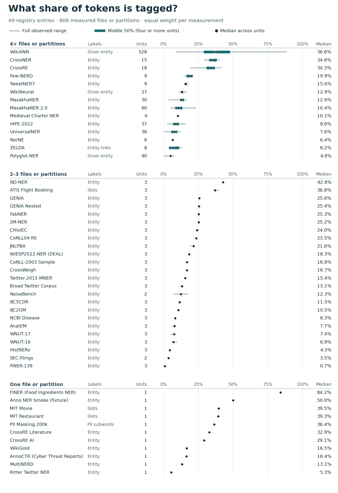

# Which datasets do the figures cover?

The November 26, 2026 survey accounts for all **462 Anno registry entries**. It measured records, annotations or tokens for **124** of them. Of those, **49** supplied a tagged-token numerator and a token denominator. The other **75** have counts such as documents, mentions or questions. For the remaining **338** entries, the inventory gives the reason each surveyed source stopped. A registry ID can represent a full corpus, a named subset or an authored fixture. [One row per registry ID, including exclusions](dataset-coverage.csv) · [Registry revision](https://github.com/arclabs561/anno/blob/d2e00aa/crates/anno-eval/src/eval/dataset_registry.rs)

News, biomedical and Wikipedia each have 13 measured entries, out of 63 news entries, 35 biomedical entries and 21 Wikipedia entries. None of the 17 entries classified as clinical supplied a corpus count. When sizing a clinical review, collect a sample from the intended source before borrowing a rate from the biomedical entries. The chart shows the eight largest domains by registry size. The CSV includes all 89 domain labels and counts each ID once. [Counts by domain](dataset-coverage-by-domain.csv)

## What the readers actually opened

| Source | What was measured | Where to find the precise input |
|---|---|---|
| Registry links, release archives and Anno fixtures | 72 measured files or archive members for 52 IDs. Twenty-three supplied tagged tokens. One more file was a PDF. | [File URL or local path, subset, units, counts, bytes, SHA-256 and failure reason](dataset-direct-files.csv) · [Registry entries and their declared splits](dataset-figure-inventory.csv) |
| Pinned publisher repositories | 672 measured files for 39 IDs, containing 20,548,152 token positions. Of those files, 212 had entity or entity-link labels. The others contributed syntactic words or part-of-speech tokens. | [Repository, commit, file, language or domain, split, metric and SHA-256](dataset-repo-files.csv) |
| Hugging Face releases | 939 measured partitions for 37 IDs. The reader counted 495,156,631 token occurrences in 759 labelled partitions, 5,848,741 tokens in two unlabelled partitions, and 6,070,231 records in 178 other partitions. A partition means one configuration and split. | [Publisher and conversion revisions, configuration, split, measured and provider counts](dataset-hf-splits.csv) |
| GitHub release search | Reviewed 180 registry pointers and measured records for 22 IDs from 197 distinct source files. One SciCo archive contains three measured split files. For example, BBQ contributes 58,492 questions, GAP 4,454 pronoun decisions, and MedMentions 4,392 documents with 352,496 mention annotations. | [Per-file units, counts, release paths and unresolved pointers](dataset-github-sources.csv) |

The Hub scan read 32,617,463 row occurrences. Polyglot-NER alone accounts for 365,934,609 tokens across 40 language partitions, including 17,794,769 marked with automatically generated entity labels. Its combined configuration lacked complete pinned shards. UniversalNER contributes 77,918 sentences across 36 released partitions. Mewsli-X contributes 17,615 mention records in its 22 development and test files. [Hugging Face partition and file ledger](dataset-hf-splits.csv)

The three Zenodo releases count different units.

- **TweetNERD.** All 14 public tables contain 475,990 rows across 340,609 distinct tweet IDs. Counting distinct tweet ID and UTF-16 offset pairs gives 356,230 mention spans. Another 119,645 rows explicitly mark tweets without an entity. The release omits full tweet text, so these tables supply no token denominator. [Publisher release](https://doi.org/10.5281/zenodo.6617192) · [Counting script](../../scripts/tweetnerd_survey.py)
- **Distant Listening Corpus.** The combined table and the per-piece archive both contain the same 242,867 catalogued harmonic annotations, with matching positions and labels across 1,283 annotated scores. The project archive also has 3,100 repeated rows from older tables and 199 rows from an alternate analysis. [Publisher release](https://zenodo.org/records/15150283) · [File-level totals and comparison digest](dataset-direct-files.csv)
- **MedievalCharterNER.** All four annotated text files cover 7,659 distinct charter IDs. Person or place annotations cover 243,719 of 2,398,381 nonempty tokens across training, validation, test and the separate Nesle/Eslonza collection. The reader verified the text members and ZIP directory. Embeddings, model files and logs are outside the figure. [Publisher release](https://zenodo.org/records/6463699) · [Four member hashes and split counts](dataset-direct-files.csv)

The same source can be reached several ways. For example, 15 CrossNER and 59 MasakhaNER2 partitions agree across publisher files and their Hub conversions. FabNER offers several encodings of the same sentences. TweetNER7 publishes the yearly training sets and their union. Adding the record or token columns across these rows would count some text more than once. The coverage figure counts each registry ID once across routes. Use the source ledgers to select a partition before adding observations. [Per-ID source routes](dataset-coverage.csv) · [Hugging Face partition notes](dataset-hf-splits.csv) · [Format and language coverage of the direct reader](../figures/anno-selection.png)

## How much of the text carries an annotation?

### Estimate review volume for a WikiANN language

To estimate how much text a reviewer will see highlighted, start with the target language’s training split. Across all 176 measured WikiANN languages, its tagged-token rate came within **5 percentage points** of the test rate for **143 languages**. Using the median training rate of the other 175 languages did so for **52**. The median absolute error fell from **9.36 to 1.17 points**. On development splits the corresponding errors were 9.19 and 0.93 points. Each language has equal weight. The rates measure token positions covered by WikiANN’s automatically generated annotations. [Counts, estimates and errors for every language and split](dataset-wikiann-split-density.csv)

### Compare annotation density across datasets

The chart below covers **49 registry entries and 908 measured files or partitions** after collapsing known duplicates within each ID. Each file contributes one tagged-token percentage. The dot gives the median, the thin line gives the observed range, and the thick line gives the middle 50% for entries with at least four observations. Overlapping entity annotations count a covered token once. The first group has enough measured units to show variation, while the 11 entries in the last group have just one observed rate each. [Medians, quartiles, endpoints and source denominators](dataset-density-ranges.csv)

| Planning question | What the source shows | How to use it |
|---|---|---|
| How much does a typical language partition vary? | The middle half of WikiANN’s 528 language splits spans 28.7–47.7% tagged tokens. For Polyglot-NER’s 40 language partitions it spans 4.3–5.5%. | Use the target corpus’s own labels when estimating review volume. Both releases supply automatically generated labels. |
| How much does the annotation task matter? | Flight booking marks 24,194 / 65,364 words as slots (37.0%) across all ATIS train, dev and test utterances. FINER marks 1,177,660 / 1,397,960 tokens (84.2%) as food ingredients in its combined release. | Budget separately for a slot-filling interface and an ingredient annotation interface. FINER supplies no split boundaries in that file. |
| How much material will a CrossRE reviewer see? | All 18 files cover six domains and three splits. The news test file has 1,344 entity-covered tokens in 400 sentences. Music has 6,870 in 399. | Use the domain-specific count for a review queue. Model prompt scores are available for AI and literature. [Six-domain test comparison](crossre-full-prompt-comparison.md#which-other-domains-did-the-corpus-survey-cover) |

## What was left out

The per-ID CSV distinguishes a missing corpus measurement from a missing token-label denominator. Filter `measured = 0` for the former and `measured = 1, tagged_tokens_measured = 0` for the latter. Read `outstanding_reason` and the source-specific status columns. A partially measured ID can still have failed files, unverified partitions or excluded encodings. For those, follow its ID into the file and split ledgers. [Complete coverage and reasons](dataset-coverage.csv)

- **Unresolved sources.** The GitHub search returned 404 for 54 repository or tree pointers. Another 45 entries pointed to the same general collection without a verified matching release. The registry also contains papers, catalog pages, unreleased data, sources requiring registration or author contact, and corpora requiring a provisioned local copy. [GitHub source outcomes](dataset-github-sources.csv) · [Registry source and access labels](dataset-figure-inventory.csv)
- **Partial or failed reads.** Two pinned publisher files failed tag validation, one in MasakhaNER2 and one in ZELDA. Other verified files for those datasets remain in the survey. The AviationProductsNER link returned a PDF. [File-level errors](dataset-repo-files.csv) · [Direct download outcomes](dataset-direct-files.csv)
- **Duplicates and scope mismatches.** FINERFood points to the FINER release. LatinITTB points to the LatinUD treebank. The CrossRE AI and literature registry subsets also appear in the full CrossRE release. The registry-linked CoNLL2003Sample Hub files cover full English splits. The linked MultiNERD file covers English test only. [Publisher manifest](dataset-repo-files.csv) · [Hub scope notes](dataset-hf-splits.csv)
- **Counts without a comparable label denominator.** Document, mention, question, POS and dependency counts can describe a release without giving a fraction of entity-tagged tokens. The two supplemental TweetNER7 partitions contain 5,848,741 unlabelled tokens. FictionNER750M reports 890,413,780 tokens in its summary across 14,601 documents. The reader verified the summary arithmetic and left the original text unmeasured. [Measured and provider columns](dataset-hf-splits.csv)

Of the 338 entries without a content measurement, 272 carry the registry label `Public` and six carry `HuggingFace`. The other 60 are marked registration (18), contact authors (18), deprecated (8), dependent on another source (7), unreleased (7) or local (2). A public entry can still point to a paper, a moved release or an unverified mirror. [Filterable access labels and reasons](dataset-coverage.csv)

## What the S3 cache establishes

The November 25 authenticated inventory listed **293 objects** and found payloads for **60 registry IDs**. The objects comprised 60 legacy payloads, 11 snapshots, 11 pointers, 11 manifests and 200 unrecognized keys. Five payloads fell under shared-read exclusions and three required a local source. The verifier compared WikiGold's S3 and publisher inputs down to the token labels and 3,558 entity spans. [Inventory and WikiGold verification](https://github.com/arclabs561/anno/actions/runs/45628266135/job/139254208115) · [Verification scope](../S3_CACHE_CI.md#verify-the-live-dataset-cache)

**Five measured publisher files can be tied to S3 by their input SHA-256.** WikiGold has the dedicated comparison. For the other four, the trusted matrix logged the same digest on an S3 read that the figure survey recorded on its publisher file. Each row below identifies the particular input a reviewer can reproduce. Those files already contribute to the survey totals. [Full file hashes and counts](dataset-direct-files.csv) · [Hub token counts](dataset-hf-splits.csv) · [Matrix precheck digests](dataset-matrix-evidence.csv)

| Dataset and matched input | Measured contents of that input | SHA-256 prefix |
|---|---|---|
| WikiGold, full linked release | 6,431 tagged / 39,007 tokens | `c797a64d0cf7` |
| GAP, test | 2,000 pronoun decisions | `1c35e36d5b14` |
| JNLPBA, test | 19,392 tagged / 101,039 tokens | `87c9b8f1f7fc` |
| NCBI Disease, test | 2,047 tagged / 24,497 tokens | `5f27802a200c` |
| MultiNERD, English test | 45,583 tagged / 347,025 tokens in 16,454 records | `f89c5544643e` |

The frozen ledger collected 143 prechecks across 15 IDs from 100 successful default-branch CI runs. Eighteen runs exposed structured prechecks, 44 trusted logs had none and 38 had no trusted matrix job log. Of the 143 observations, 39 came from S3, 83 from local cache and 21 from a publisher URL. The **nine IDs** with S3 prechecks resolve to **eight distinct payload digests** because CoNLL2003Sample and OntoNotesSample shared `0632f32c090e`. That payload, and the cache inputs for BC5CDR, ViraDialogActsLive and WikiANN, have no matching file hash in the survey ledgers. For WikiANN, the relationship between that cached input and the 528 measured Hub partitions remains unknown. [Precheck ledger](dataset-matrix-evidence.csv) · [Hub partition ledger](dataset-hf-splits.csv)

The November 26 evaluation on `main` shows how to check what a model actually scored. In `eval-sanity-report.json`, both the heuristic and stacked WikiGold runs recorded `provenance.dataset.data_source = "S3 cache"` and the WikiGold digest above. Each scored 20 sentences with 52 gold mentions at seed 42. In the separate matrix job, prechecks staged GAP and CoNLL2003Sample from S3, then every one of its 10 model outcome rows reported a local cache read. Use the full file for corpus statistics and the benchmark receipt for the model's sample size. [Scored benchmark artifact](https://github.com/arclabs561/anno/actions/runs/45795846544/artifacts/15105012106) · [Matrix decision and outcome artifact](https://github.com/arclabs561/anno/actions/runs/45795846544/artifacts/15104598979) · [Trusted CI run](https://github.com/arclabs561/anno/actions/runs/45795846544)

## Which figure belongs in which guide?

| Reader's decision | Figure and evidence |
|---|---|
| Choose a benchmark that can score the intended output | The QA guide follows typed spans, a coreference cluster and a directed relation through one authored JEREX example. [Benchmark chooser](../QA.md#find-a-dataset-or-add-a-case) |
| Estimate how much of a WikiANN test split will be highlighted | The same language’s training split estimated held-out annotation density more accurately for 155 of 176 languages. [Split comparison](#estimate-review-volume-for-a-wikiann-language) |
| Decide whether to investigate detection or type assignment on unfamiliar names | Domain QA compares six archived submissions on the same WNUT-17 test sentences. Among the 499 unfamiliar mentions all six missed, 169 had exact boundaries with a wrong type and 232 had no overlapping prediction. [Unfamiliar names](../DOMAIN_QA.md#test-recognition-of-unfamiliar-names) |
| Decide whether counting visible highlights is a sound recall check | Extraction workflows applies the HTML exporter’s overlap rule to every reference mention in the three GENIA splits. It hides 5,031 of 55,740. [Overlapping highlights](../EXTRACTION_WORKFLOWS.md#review-overlapping-highlights) |
| Interpret an F1 gain when a relation prompt can see test labels | Across all six CrossRE domains, 1,338 of 2,446 test sentences give away either the absence of a relation or its only possible predicate type. AI and literature also have paired model outputs. [Prompt comparison](crossre-full-prompt-comparison.md) |
| Decide where a backend comparison needs more examples | Paired intervals favor GLiNEREL-72m over Anno’s heuristic in all ten RED-FM groups. Three of the four MultiNERD intervals span zero. [NER across languages and input lengths](ner-language-length.md#paired-glinerel-and-heuristic-results) |

Two model comparisons remain open. A decision about an Anno backend on unfamiliar names needs that backend’s predictions on the WNUT-17 sentences. A decision about CrossRE prompt sensitivity in music, news, politics or science needs paired fixed-vocabulary and gold-prompt predictions for the same inputs. The released corpus counts supply the denominators for both comparisons. [Figure generation and raw-input replay commands](../../scripts/README.md#reproduce-the-dataset-figures)
