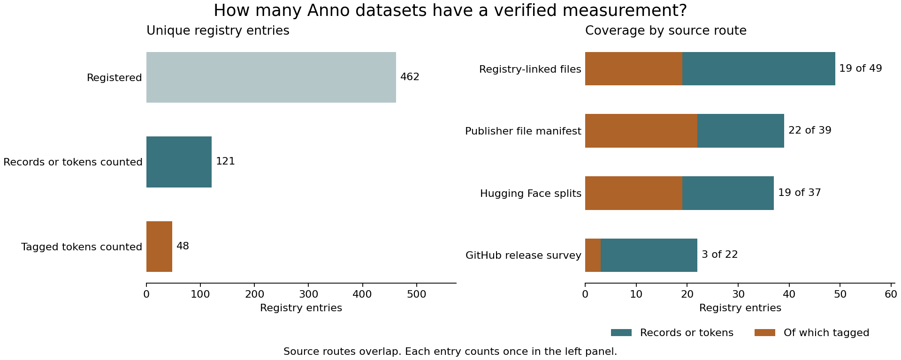
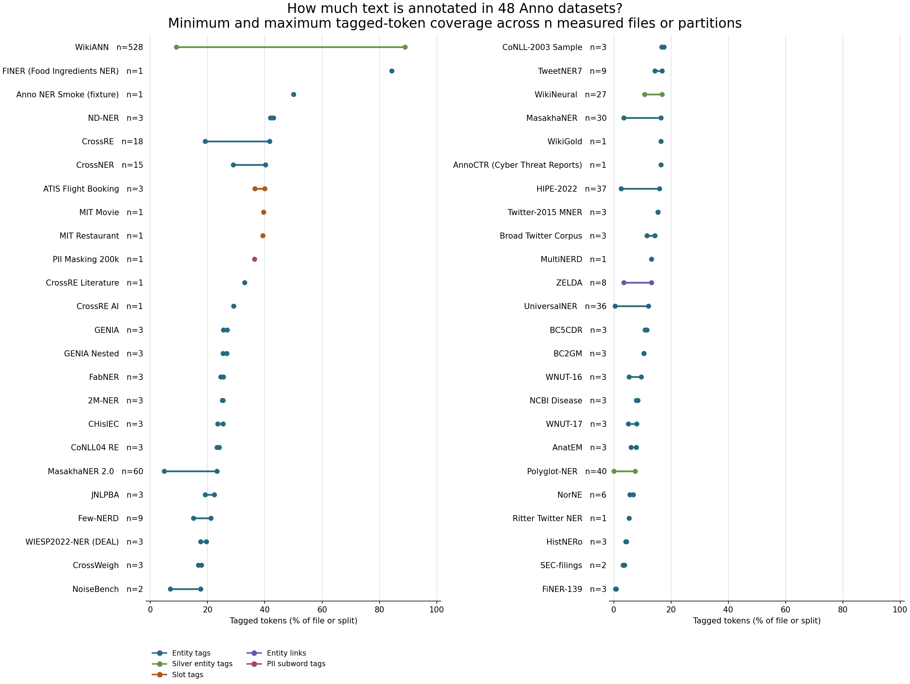

# Which datasets do the figures cover?

The November 26, 2026 survey accounts for all **462 Anno registry entries**. It measured records, annotations or tokens for **121** of them. Of those, **48** supplied a tagged-token numerator and a token denominator. The other **73** have counts such as documents, mentions or questions. For the remaining **341** entries, the inventory gives the reason each surveyed source stopped. A registry ID can represent a full corpus, a named subset or an authored fixture. [One row per registry ID, including exclusions](dataset-coverage.csv) · [Registry revision](https://github.com/arclabs561/anno/blob/d2e00aa/crates/anno-eval/src/eval/dataset_registry.rs)

## What the readers actually opened

| Source | What was measured | Where to find the precise input |
|---|---|---|
| Registry links, release archives and Anno fixtures | 52 measured files for 49 IDs. Nineteen files supplied tagged tokens. One more file was a PDF and 17 download attempts failed across three IDs. | [File URL or local path, subset, units, counts, bytes, SHA-256 and failure reason](dataset-direct-files.csv) · [Registry entries and their declared splits](dataset-figure-inventory.csv) |
| Pinned publisher repositories | 672 measured files for 39 IDs, containing 20,548,152 token positions. Of those files, 212 had entity or entity-link labels. The others contributed syntactic words or part-of-speech tokens. | [Repository, commit, file, language or domain, split, metric and SHA-256](dataset-repo-files.csv) |
| Hugging Face releases | 939 measured partitions for 37 IDs. The reader counted 495,156,631 token occurrences in 759 labelled partitions, 5,848,741 tokens in two unlabelled partitions, and 6,070,231 records in 178 other partitions. A partition means one configuration and split. | [Publisher and conversion revisions, configuration, split, measured and provider counts](dataset-hf-splits.csv) |
| GitHub release search | Reviewed 180 registry pointers and measured records for 22 IDs from 197 distinct source files. One SciCo archive contains three measured split files. For example, BBQ contributes 58,492 questions, GAP 4,454 pronoun decisions, and MedMentions 4,392 documents with 352,496 mention annotations. | [Per-file units, counts, release paths and unresolved pointers](dataset-github-sources.csv) |

The Hub scan read 32,617,463 row occurrences. Polyglot-NER alone accounts for 365,934,609 tokens across 40 language partitions, including 17,794,769 marked with automatically generated entity labels. Its combined configuration lacked complete pinned shards. UniversalNER contributes 77,918 sentences across 36 released partitions. Mewsli-X contributes 17,615 mention records in its 22 development and test files. [Hugging Face partition and file ledger](dataset-hf-splits.csv)

The same source can be reached several ways. For example, 15 CrossNER and 59 MasakhaNER2 partitions agree across publisher files and their Hub conversions. FabNER offers several encodings of the same sentences. TweetNER7 publishes the yearly training sets and their union. Adding the record or token columns across these rows would count some text more than once. The coverage figure counts each registry ID once across routes. Use the source ledgers to select a partition before adding observations. [Per-ID source routes](dataset-coverage.csv) · [Hugging Face partition notes](dataset-hf-splits.csv) · [Format and language coverage of the direct reader](figures/anno-selection.png)

## How much of the text carries an annotation?

For each measured file or split, divide the number of token positions inside a supplied annotation by all token positions in that unit. The figure plots the observed extremes across 904 file or partition measurements grouped by registry ID after collapsing known duplicates within an ID. A single dot means the minimum and maximum coincide. Gold entity spans count each covered token once even when spans overlap. The colors distinguish entity labels, automatically produced silver labels, slots, entity links and PII subwords. [Exact endpoints, denominators and source partitions](dataset-density-ranges.csv)

| Planning question | What the source shows | How to use it |
|---|---|---|
| Can one WikiANN rate size a multilingual review? | Across 176 language configurations and 528 splits, Pashto training has 220 / 2,405 tokens tagged (9.1%). Volapük test has 376 / 423 (88.9%). | Size a sample from the target language and split. A small split can set the endpoint. |
| How much does the annotation task matter? | Flight booking marks 24,194 / 65,364 words as slots (37.0%) across all ATIS train, dev and test utterances. FINER marks 1,177,660 / 1,397,960 tokens (84.2%) as food ingredients in its combined release. | Budget separately for a slot-filling interface and an ingredient annotation interface. FINER supplies no split boundaries in that file. |
| How much material will a CrossRE reviewer see? | All 18 files cover six domains and three splits. The news test file has 1,344 entity-covered tokens in 400 sentences. Music has 6,870 in 399. | Use the domain-specific count for a review queue. Model prompt scores are available for AI and literature. [Six-domain test comparison](crossre-full-prompt-comparison.md#which-other-domains-did-the-corpus-survey-cover) |

## What was left out

The per-ID CSV distinguishes a missing corpus measurement from a missing token-label denominator. Filter `measured = 0` for the former and `measured = 1, tagged_tokens_measured = 0` for the latter. Read `outstanding_reason` and the source-specific status columns. A partially measured ID can still have failed files, unverified partitions or excluded encodings. For those, follow its ID into the file and split ledgers. [Complete coverage and reasons](dataset-coverage.csv)

- **Unresolved sources.** The GitHub search returned 404 for 54 repository or tree pointers. Another 45 entries pointed to the same general collection without a verified matching release. The registry also contains papers, catalog pages, unreleased data, sources requiring registration or author contact, and corpora requiring a provisioned local copy. [GitHub source outcomes](dataset-github-sources.csv) · [Registry source and access labels](dataset-figure-inventory.csv)
- **Partial or failed reads.** Two pinned publisher files failed tag validation, one in MasakhaNER2 and one in ZELDA. Other verified files for those datasets remain in the survey. Three Zenodo releases returned errors on all attempted payloads. The AviationProductsNER link returned a PDF. [File-level errors](dataset-repo-files.csv) · [Direct download outcomes](dataset-direct-files.csv)
- **Duplicates and scope mismatches.** FINERFood points to the FINER release. LatinITTB points to the LatinUD treebank. The CrossRE AI and literature registry subsets also appear in the full CrossRE release. The registry-linked CoNLL2003Sample Hub files cover full English splits. The linked MultiNERD file covers English test only. [Publisher manifest](dataset-repo-files.csv) · [Hub scope notes](dataset-hf-splits.csv)
- **Counts without a comparable label denominator.** Document, mention, question, POS and dependency counts can describe a release without giving a fraction of entity-tagged tokens. The two supplemental TweetNER7 partitions contain 5,848,741 unlabelled tokens. FictionNER750M reports 890,413,780 tokens in its summary across 14,601 documents. The reader verified the summary arithmetic and left the original text unmeasured. [Measured and provider columns](dataset-hf-splits.csv)

Of the 341 entries without a content measurement, 275 carry the registry label `Public` and six carry `HuggingFace`. The other 60 are marked registration (18), contact authors (18), deprecated (8), dependent on another source (7), unreleased (7) or local (2). A public entry can still point to a paper, a moved release or an unverified mirror. [Filterable access labels and reasons](dataset-coverage.csv)

## What the S3 cache establishes

The authenticated cache verification listed **293 objects** and matched payloads to **60 registered dataset IDs**. It found 60 legacy payloads, 11 snapshots, 11 pointers, 11 manifests and 200 unrecognized keys. Five payloads were excluded from shared reads and three required a local source. The job verified WikiGold against its publisher input, including 39,007 tokens and 3,558 entity spans. The direct reader recorded the same input SHA-256. [Trusted cache verification](https://github.com/arclabs561/anno/actions/runs/45628266135) · [WikiGold file digest](dataset-direct-files.csv) · [Cache verification scope](../S3_CACHE_CI.md#verify-the-live-dataset-cache)

Of the 100 successful default-branch CI runs examined, 18 exposed structured prechecks, 44 trusted matrix logs had no structured prechecks and 38 runs had no trusted matrix job log. The 143 observations cover 15 named IDs. CI reported S3 on 39 observations across BC5CDR, CoNLL2003Sample, GAP, JNLPBA, MultiNERD, NCBIDisease, OntoNotesSample, ViraDialogActsLive and WikiANN. It reported local cache on 83 observations and an original URL on 21. This survey checkout received HTTP 403 on direct bucket access. Only WikiGold had the separate byte-for-byte S3 comparison above. The other corpus counts in these figures come from the cited releases or checked-in fixtures. [Run IDs, sources and observed digests](dataset-matrix-evidence.csv) · [Example trusted CI run](https://github.com/arclabs561/anno/actions/runs/45760094157)

## Which figure belongs in which guide?

| Reader's decision | Figure and evidence |
|---|---|
| Choose a benchmark that can score the intended output | The QA guide follows typed spans, a coreference cluster and a directed relation through one authored JEREX example. [Benchmark chooser](../QA.md#find-a-dataset-or-add-a-case) |
| Check whether training-name lookup can cover a social-media holdout | Domain QA compares every development and test mention in WNUT-17 with all training annotations. Even case-folded lookup misses 1,055 of 1,079 test occurrences. [Unfamiliar names](../DOMAIN_QA.md#test-recognition-of-unfamiliar-names) |
| Decide whether counting visible highlights is a sound recall check | Extraction workflows applies the HTML exporter’s overlap rule to every reference mention in the three GENIA splits. It hides 5,031 of 55,740. [Overlapping highlights](../EXTRACTION_WORKFLOWS.md#review-overlapping-highlights) |
| Interpret the F1 lift when a relation prompt can see test labels | The CrossRE report pairs model outputs on all 431 AI and 416 literature test sentences. The other four domains have corpus counts only. [Prompt comparison](crossre-full-prompt-comparison.md) |

Two plots would answer questions the corpus counts leave open. In Domain QA, a seen-versus-unseen recall plot would show whether a particular backend recovers unfamiliar names. It needs saved predictions on the same WNUT test sentences and separate gold counts for each group. In the CrossRE report, adding the four remaining domains to the paired prompt plot would show whether the observed gains persist across genres. It needs fixed-vocabulary and gold-prompt predictions with matching sample digests. [Figure generation and raw-input replay commands](../../scripts/README.md#reproduce-the-dataset-figures)
