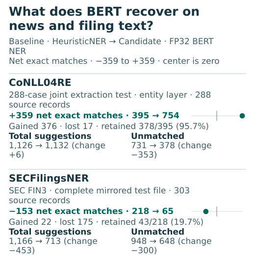

# Where does BERT earn its review cost?

**Use BERT for the entity layer of this CoNLL04 news test. Keep the heuristic as the baseline for FIN3’s typed party references.** On news, BERT found 359 more exact mentions with six more suggestions. On FIN3, it issued 453 fewer suggestions and lost 153 net exact mentions. A reviewer filtering on PER would lose most references to the borrower and lender. [Full counts and pinned sources](english-ner-source-replay.json)



[Accessible chart and tables](../figures/english-ner-source-paired.html) · [Portable chart data](english-ner-source-paired.json)

| Complete test file | Backend | Exact / gold | Suggestions | Unmatched | Precision | Recall | F1 |
|---|---|---:|---:|---:|---:|---:|---:|
| CoNLL04 entity layer | Heuristic | 395 / 1,079 | 1,126 | 731 | 35.1% | 36.6% | 35.8% |
| CoNLL04 entity layer | BERT | 754 / 1,079 | 1,132 | 378 | 66.6% | 69.9% | 68.2% |
| SEC FIN3 | Heuristic | 218 / 318 | 1,166 | 948 | 18.7% | 68.6% | 29.4% |
| SEC FIN3 | BERT | 65 / 318 | 713 | 648 | 9.1% | 20.4% | 12.6% |

An exact match requires the same Unicode character boundaries and type. The table charges every native output to the review queue, including repeated spans, types with no matching source category, and suggestions on empty-gold sentences. Of 303 FIN3 sentences, 203 have no gold. The heuristic produced 396 suggestions across 169 of those sentences. BERT produced 214 across 106. On the 100 sentences containing gold, the heuristic and BERT reached 40.1% and 15.9% F1 respectively.

## Why the news result reverses on FIN3

FIN3 is one subordinated loan agreement. Its annotation policy treats repeated contract-party terms as people. The two most frequent case-folded PER surfaces account for 196 of the 216 person mentions. After looking at the difference between systems, we counted each of these two terms on the entire file.

| Gold PER surface | Gold mentions | Exact PER, heuristic → BERT | PER gained / lost | Exact boundary under any type, heuristic → BERT |
|---|---:|---:|---:|---:|
| Borrower | 131 | 116 → 14 | 3 / 105 | 119 → 80 |
| Lender | 65 | 56 → 0 | 0 / 56 | 60 → 59 |
| All other PER surfaces | 20 | 11 → 7 | 1 / 5 | 11 → 7 |

For 115 of the 161 lost `Borrower` or `Lender` PER matches, BERT found the exact boundaries and called the party an organization. Two became MISC at the same span, one partially overlapped, and 43 had no overlapping prediction. If the reviewer accepts any predicted type, BERT still surfaces 139 of the 196 role references at the exact boundary, compared with the heuristic’s 179. Anno’s next contract test should score defined-party references separately from named counterparties in an independently annotated agreement. A surface rule learned on recurring words in FIN3 needs that independent test before it can support a shipping decision.

On CoNLL04 the exact gains span all three shared types. The heuristic and BERT found 165 and 277 PER, 77 and 141 ORG, and 153 and 336 LOC. Restricting both gold and suggestions to PER, ORG and LOC raises BERT’s news F1 to 76.9%, against 38.1% for the heuristic. FIN3 still favors the heuristic on the same three types, 29.5% to 16.5%. The ONNX checkpoint derives from `dslim/bert-base-NER`, fine-tuned on the English CoNLL-2003 news task. This study did not audit overlap with its pretraining or fine-tuning data. [Counts by type](english-ner-source-replay.json) · [Underlying model card](https://huggingface.co/dslim/bert-base-NER)

## What the reader and scorer actually used

| Source test | Record identity | Cases / distinct texts | Tokens / tagged | Source gold |
|---|---|---:|---:|---|
| CoNLL04 adapted joint-extraction release | Numeric `#doc` identifier | 288 / 287 | 8,408 / 2,024 | Peop 321, Org 198, Loc 427, Other 133 |
| SEC FIN3 mirror | File plus ordinal of each nonempty sentence block | 303 / 299 | 13,246 / 436 | PER 216, ORG 56, LOC 39, MISC 7 |

The CoNLL04 reader at `fe6a4c1` interpreted token indices as words and relation fields and document numbers as types. Its native export produced one case, 1,275 supposed mentions and 298 distinct labels. The corrected reader splits at `#doc`, reads the source token and BIO columns and preserves the entity layer. We corroborated every resulting gold type and boundary against a separate reader of the pinned test file. The scores here evaluate NER only. CoNLL04’s relation annotations, training and development splits are outside this measurement. [Adapted CoNLL04 test file](https://github.com/bekou/multihead_joint_entity_relation_extraction/blob/7f40a0f7c1892821591358518c542139e88f693e/data/CoNLL04/test.txt) · [Roth and Yih, 2004](https://aclanthology.org/W04-2401/)

The FIN3 test directory in the pinned mirror contains one file. FIN5 is training material and contributes zero cases to the scores. The dataset authors release the financial corpus under CC BY 3.0 and request citation of Julio Cesar Salinas Alvarado, Karin Verspoor and Timothy Baldwin (2015), *Domain Adaption of Named Entity Recognition to Support Credit Risk Assessment*. The corrected SEC registry entry names the release’s four entity types. [FIN3 source](https://github.com/juand-r/entity-recognition-datasets/blob/8522f4b39cf9ed323b77f2d8a5005628f8861908/data/SEC-filings/CONLL-format/data/test/FIN3.txt) · [Corpus citation and license](https://github.com/juand-r/entity-recognition-datasets/blob/8522f4b39cf9ed323b77f2d8a5005628f8861908/data/SEC-filings/README.txt)

Source tokens are joined with a single space. Each record retains its ordinal even when two reconstructed strings match. Native dataset reports and batch inputs must agree on the SHA-256 of each text. Native reports must also match the independently fingerprinted source label and character span of every gold mention. Paired gains and losses compare exact gold identities on the same record. The procedure counts each gold mention at most once.

The reader maps CoNLL04 Peop, Org and Loc to PER, ORG and LOC. CoNLL04 Other remains a distinct category. Both models missed all 133 Other mentions. BERT’s 118 MISC outputs on news remain in its review total. On FIN3 the scorer accepts the spelling `misc` from the BERT backend for source MISC. This accounts for three extra exact matches above the 62 in a literal native report. BERT issued 274 MISC suggestions for seven FIN3 gold MISC spans. [Gold and prediction label mappings](english-ner-source-replay.json)

BERT repeated two identical typed predictions on news and one on FIN3. Counterfactually removing just those duplicates would leave 1,130 and 712 suggestions, with the same 754 and 65 exact matches. BERT also offered competing types at nine news boundaries and eight FIN3 boundaries. The measured workload includes all of them. These fixed-split counts cover one adapted news test and one agreement. They give no between-agreement estimate or deployment timing.

## Replay offline

Use Python 3.11 or newer, an ONNX-enabled Anno build and a local FP32 copy of the checkpoint. The measured Linux build used Anno 0.16.0, ONNX Runtime 1.24.2 and `cargo build --locked -p anno-cli --no-default-features --features onnx,eval,extractor-html2text`. Supply `model.onnx`, `tokenizer.json` and `config.json` under `BERT`. The replay verifies their individual digests and selects only those three files. [Pinned BERT checkpoint](https://huggingface.co/protectai/bert-base-NER-onnx/tree/84d28ab2bc28401b4353b26033eb043c8c8a0739) · [Executable replay](../../scripts/qa/english_ner_source_replay.py)

From the offline bundle, extract FIN3 from `publisher/publisher-general.zip`. Set `ANNO` to the absolute path of the binary built from this study. The following command replays FIN3 on its own. Run from the repository root.

```sh
unzip -p "$OFFLINE_BUNDLE/publisher/publisher-general.zip" \
  data/juand-r/entity-recognition-datasets/8522f4b39cf9ed323b77f2d8a5005628f8861908/data/SEC-filings/CONLL-format/data/test/FIN3.txt > FIN3.txt
python3 scripts/qa/english_ner_source_replay.py replay \
  --anno "$ANNO" --bert "$BERT" --sec FIN3.txt \
  --output replay.json --paired paired.json
"$ANNO" viz paired paired.json -o paired.html
```

To reproduce both published rows, add `--conll04 /absolute/path/to/test.txt` with a locally obtained copy of the pinned news file. The offline bundle records the CoNLL04 locator and digest. The raw newspaper text requires separate access. To reproduce the historic `prior_reader` block too, add `--prior-anno /absolute/path/to/earlier/anno` built from `fe6a4c1fcbc4c0d2096224e3336a9a14facc7b6a` with the same features. To redraw both published rows directly from the aggregate offline, run the following commands.

```sh
python3 scripts/qa/english_ner_source_replay.py chart \
  docs/eval/english-ner-source-replay.json paired.json
"$ANNO" viz paired paired.json -o paired.svg
```
