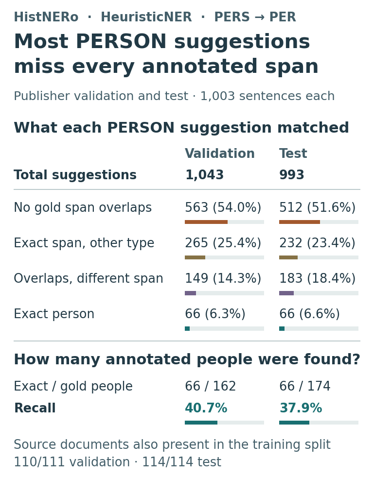

# What does Anno find in historical Romanian newspapers?

**Use HistNERo’s aligned gold for model comparisons. Audit the heuristic’s person suggestions before using them as an index of names.** On the 1,003 validation sentences the heuristic returned 1,043 person suggestions. Only 66 exactly matched one of the 162 published people, for **6.3% precision and 40.7% recall**. The literal source-label score credited zero of those people because the source writes `PERS` and the backend emits `PER`. Both protocols use the same predictions. [Counts, source hashes and ordered prediction hashes](histnero-ner-scoring.json)



Of the 977 unmatched validation person suggestions, 265 landed exactly on an entity with another source type, 149 partially overlapped a gold span, and 563 had no annotated overlap. Test showed a similar pattern. Its 993 person suggestions included 66 exact people, 232 exact boundaries with another gold type, 183 partial overlaps, and 512 suggestions with no gold overlap. Of the same-boundary errors, 172 on validation and 142 on test were gold locations, followed by 86 and 81 organizations. A place-versus-person disambiguation test can target that error directly. Suggestions with no annotated overlap need their own review. A fix that suppresses suggestions should report how many of the 66 exact names it displaces on each split. [Person review workload](histnero-ner-scoring.json)

| Publisher split | Sentences | Authored / scored mentions | Suggestions | Exact matches, source → dataset | Micro F1, source → dataset |
|---|---:|---:|---:|---:|---:|
| Train | 8,020 | 5,686 / 5,686 | 9,213 | 192 → 867 | 2.58% → 11.64% |
| Validation | 1,003 | 675 / 673 | 1,222 | 17 → 83 | 1.79% → 8.76% |
| Test | 1,003 | 690 / 690 | 1,179 | 35 → 101 | 3.75% → 10.81% |

All 807 newly credited exact mentions come from aligning the person label. Trimming separator padding gained and lost zero exact matches. The heuristic emitted no DATE or PRODUCT on any split. On validation that leaves 49 dates and 40 scorable products beyond the reach of these outputs. [Per-type results under both protocols](histnero-ner-scoring.json)

## What the splits measure

The publisher’s ten thousand sentences comprise 129 source document IDs in train, 111 in validation and 114 in test. Of the validation documents, 110 also occur in train, covering 1,002 of the 1,003 validation sentences. All 114 test documents occur in train. Exactly 21 validation sentences and 23 test sentences have reconstructed text also found in train. These are held-out **sentence** splits. A claim about transfer to new newspapers requires a document-held-out evaluation. This replay runs the built-in heuristic with its existing settings and fits no parameters. [Source-scope counts](histnero-ner-scoring.json)

## How scoring works

The authors describe five entity types. Their explicit class dictionary assigns the beginning and inside indices for *person* to `PERS` and for *product* to `PROD`. `anno dataset eval --dataset HistNERo` uses those published meanings to compare against `PER` and `PRODUCT`. The model sees the same source tokens, joined with one ASCII space. `--ner-scoring source` retains the original extents and compares literal label spellings on both gold and prediction. This explicit mode also supports other NER corpora. The dataset policy adds these aliases only for HistNERo. [Authors’ dataset description](https://github.com/avramandrei/histnero/blob/a105f3950570b8d92410fecce85ea06af32d8a86/README.md) · [Pinned class dictionary](https://huggingface.co/datasets/avramandrei/histnero/blob/433ca166efac28c952813c0e78bf301643cf5af3/README.md)

The original files contain 66 empty token strings, including 15 with entity tags. Two validation `B-PROD` singletons have zero character width. Source mode keeps these in the denominator. Dataset mode reports 675 authored mentions and 673 scorable mentions. Another seven nonempty spans end in an empty token, comprising six train organizations and one validation product. Their scored spans end at the last nonempty source token. Six internal empty tokens retain their spaces. All source rows, source labels and original token arrays remain available for audit. Gold ordinals stay stable when an empty reference is excluded.

The replay independently reconstructs Unicode character bounds from each original token array. It checks every native report’s source digest, gold-key digest, literal and aligned exact identities, predicted count and denominator against a separate `anno batch` run. The alias-only comparison preserves the original extents. The endpoint comparison holds the aligned labels fixed. The per-case reports under the two protocols have different gold fingerprints. For a native paired comparison of two **models**, run both under the same protocol.

## Reproduce the results

From the Anno checkout containing this study, build the CLI and fetch the pinned public files from the HistNERo authors. The scoped builder downloads all three original splits plus the authors’ notices. It verifies their digests and builds a local archive. The measurement reads the originals from that archive, reconstructs the three cache profiles and runs with downloads disabled. Python 3.11 or newer is required. The built-in heuristic needs no model weights.

```sh
cargo build --locked -p anno-cli --no-default-features --features eval,extractor-html2text
ANNO="$(pwd)/target/debug/anno"
python3 scripts/build_offline_native_cache.py ./histnero-cache \
  --anno "$ANNO" --dataset HistNERo --fetch
python3 scripts/qa/histnero_ner_scoring.py --anno "$ANNO" \
  --archive ./histnero-cache/anno-native-cache-dataset-HistNERo.zip \
  --output histnero-ner-scoring.json
```

If Cargo uses a custom target directory, set `ANNO` to the executable in that directory. For a fully offline run, point `--archive` at the previously built HistNERo archive or a native general cache ZIP containing all three published originals and their notices.

The same replay accepts `--sources /path/to/histnero` in place of the archive. Supply the original `train.json`, `valid.json`, `test.json`, the GitHub `README.md` and the pinned Hugging Face card saved as `publisher-class-labels.md`. The recorded source hashes distinguish the two notices and all three splits. Add `--prior-anno /path/to/earlier/anno` to verify the literal baseline against a binary built from `1b6fcc97df321e1614bdc94f00c9b18ab36bb49a`. The complete replay with this check compares all native prediction lists and per-case judgments. [Original split files](https://github.com/avramandrei/histnero/tree/a105f3950570b8d92410fecce85ea06af32d8a86/data) · [Replay script](../../scripts/qa/histnero_ner_scoring.py)

For an installed native cache profile, set `ANNO_CACHE_DIR` to its parent directory containing `datasets/HistNERo.cache`. The default packaged profile is test, while `profiles/HistNERo/dev` contains validation.

```sh
"$ANNO" dataset eval --cached-only --dataset HistNERo --model heuristic \
  --reports aligned.jsonl --html --output aligned.html
"$ANNO" dataset eval --cached-only --dataset HistNERo --model heuristic \
  --ner-scoring source --reports source.jsonl
"$ANNO" viz errors aligned.jsonl -o aligned-errors.html
```
