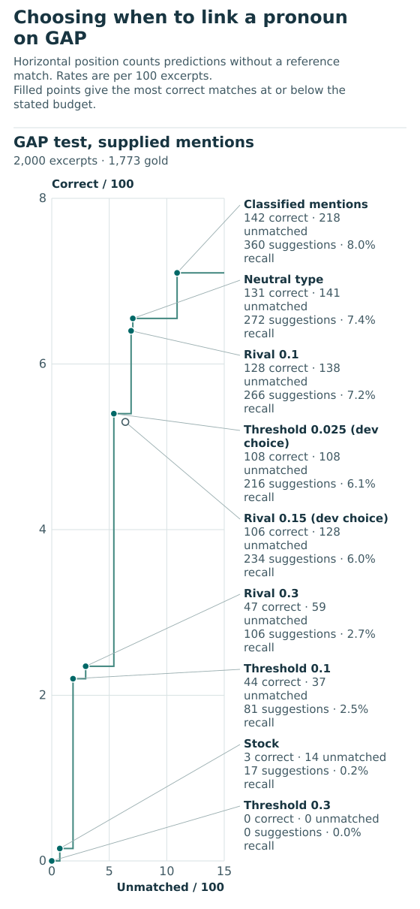

# How many correct pronoun links survive abstention?

On the 2,000 GAP test excerpts, requiring a winning score to clear the native link threshold by an extra 0.025 removed 33 wrong links and lost 23 correct ones. Requiring a lead of 0.15 over the other name removed 13 wrong links and lost 25 correct ones. Both cutoffs were chosen on development articles. On test, the threshold rule returned more correct links with fewer wrong assignments than the competing-name rule. On validation it returned nine fewer correct links and four fewer wrong ones. Neither result supports enabling a margin by default. [Aggregate results and all cutoffs](native-gap-link-retention.json)



Each point is one policy run on the same articles. Moving right adds wrong links. Moving up recovers correct ones. A filled point gives the highest correct-link count observed at or below that wrong-link budget among the displayed policies. The plot includes additional cutoffs so a caller can see the cost of stricter abstention. The marked development choices were fixed before comparing these policies on validation and test. The earlier neutral-type study had already examined all three splits. [Reusable chart input](native-gap-margin-tradeoff.json) · [Earlier neutral-type experiment](native-gap-neutral-mention.md)

## Where the native ranker loses the person

A separate trial held the wrong-link count to the stock budget of eight on development. Its selected policy reproduced stock and was tested on held-out books. Here the development rule instead required preserving at least 80% of the neutral arm's correct links. That sets a different error budget and lets us examine which abstentions discard correct identities. [Fixed wrong-link budget](native-gap-margin.md) · [Transfer to held-out books](litbank-pronoun-transfer.md)

Of the 1,773 gold links on GAP test, the neutral-type ranker recovered 131. In **902** misses the correct name was among the candidates scored for the pronoun, and its score failed to clear the native gate. In **406** the name preceded the pronoun but lay outside the 100-character search window. In **334** it followed the pronoun. No missed gold link had an above-threshold prior name that lost to a higher-scoring rival. Of the 141 wrong links, 106 had a scored rival and 35 had only one scored candidate. Expanding the search could reach additional names, but a wider search would still leave the largest group below the gate. [Counts by split, search stage and error type](native-gap-link-retention.json)

The surface-type control passed each supplied surface through Anno's existing mention classifier. The default inferred type had treated 351 of the 2,000 target pronouns as proper mentions. On test the control gained 12 correct links, lost one and added 77 wrong ones relative to the neutral-type arm. Changing the inferred type alone would make more wrong-person assignments. The next comparison worth running is a context-sensitive scorer against the current one on the 902 in-window misses, paired with wrong-person and neither-name counts on the same articles. A separate forward-search trial could establish how often the 334 later names can be linked reliably. [Native candidate trace](../../crates/anno/src/backends/coref/mention_ranking/algorithm/mod.rs) · [Supplied-span adapter](../../crates/anno/examples/coref_gap_panel.rs)

## Does the choice transfer?

Cells report **correct / wrong** pronoun-to-candidate links. Each example contributes two labeled pair decisions. On GAP either name or neither can be correct. On Winogender each sentence has one correct candidate. The retained-correct threshold for development tuning was 80% of the neutral arm's correct links. Among eligible cutoffs we minimized wrong links, breaking ties by more correct links and then by the smaller cutoff.

| Source and supplied boundaries | Examples | Gold links | Stock | Neutral type | Rival margin 0.15 | Threshold margin 0.025 | Classified mentions with neutral type |
|---|---:|---:|---:|---:|---:|---:|---:|
| GAP development | 2,000 | 1,799 | 9 / 8 | 123 / 138 | 102 / 117 | 103 / 103 | 143 / 230 |
| GAP validation | 454 | 392 | 0 / 6 | 37 / 39 | 32 / 38 | 23 / 34 | 39 / 59 |
| GAP test | 2,000 | 1,773 | 3 / 14 | 131 / 141 | 106 / 128 | 108 / 108 | 142 / 218 |
| Winogender, determiner-inclusive phrases | 720 | 720 | 0 / 0 | 65 / 57 | 35 / 33 | 52 / 48 | 9 / 7 |
| Winogender, bare role heads | 720 | 720 | 0 / 0 | 3 / 3 | 1 / 1 | 2 / 2 | 2 / 2 |

Winogender contributes 720 distinct English sentences from 120 templates. Its last two rows reuse the same sentences with different mention boundaries. Under the threshold policy, switching from bare heads to full phrases changed the result from 2 correct and 2 wrong links to 52 correct and 48 wrong. Boundary conventions must accompany a coreference comparison. All 4,454 released GAP rows and all 720 Winogender sentences entered this study. These are supplied-span decisions. Automatic mention detection, other languages and calibrated confidence probabilities are outside its scope. [GAP files](https://github.com/google-research-datasets/gap-coreference/tree/83135f26025cdd705c04f77e940d0c9201116b80) · [Winogender files and template design](https://github.com/rudinger/winogender-schemas/tree/1c7f8b481ad8a234b41e9f76a424d6e856e13f7f)

## Reproduce the trace, intervention and figure

Use a disposable checkout, the three pinned GAP TSVs in `$GAP` and Winogender's `templates.tsv` and `all_sentences.tsv` in `$WINOGENDER`. The example uses the repository's ONNX build feature. The native ranker requires no model weights. The runner verifies the source hashes, reconstructs the native connected components, and compares the complete partitions to independent Rust runs at all eight margins for both rules. At zero margin the GAP results must also match both earlier native partition fingerprints. [Runner](../../scripts/qa/native_gap_link_retention.py) · [Neutral-type patch](../../scripts/qa/fixtures/native-gap-neutral-mention.patch) · [Native margin patch](../../scripts/qa/fixtures/native-gap-score-margin.patch)

```sh
trial=$(mktemp -d)
build_worker() {
    cargo build --locked -p anno --no-default-features --features onnx --example coref_gap_panel
    cp "${CARGO_TARGET_DIR:-target}/debug/examples/coref_gap_panel" "$trial/$1"
}
build_worker stock
git apply scripts/qa/fixtures/native-gap-neutral-mention.patch
build_worker neutral
git apply scripts/qa/fixtures/native-gap-score-margin.patch
build_worker margin
git apply -R scripts/qa/fixtures/native-gap-score-margin.patch
git apply -R scripts/qa/fixtures/native-gap-neutral-mention.patch
python3 scripts/qa/native_gap_link_retention.py --gap "$GAP" --winogender "$WINOGENDER" \
    --stock "$trial/stock" --neutral "$trial/neutral" --margin-worker "$trial/margin" \
    --output "$trial/results.json" --chart "$trial/points.json"
anno viz tradeoff "$trial/points.json" -o "$trial/margins.svg"
```

For another supplied-span run, `coref_gap_panel mention-ranking --trace-ranking` takes JSONL on stdin and emits ordinary clusters on stdout. Its stderr stream records the candidate indices, character spans, scores, effective link threshold and selected parent for each mention. The optional `--classify-mentions` uses surface text to set the mention type. Neither control requires the correct antecedent as an input. [Worker and input format](../../crates/anno/examples/coref_gap_panel.rs)
