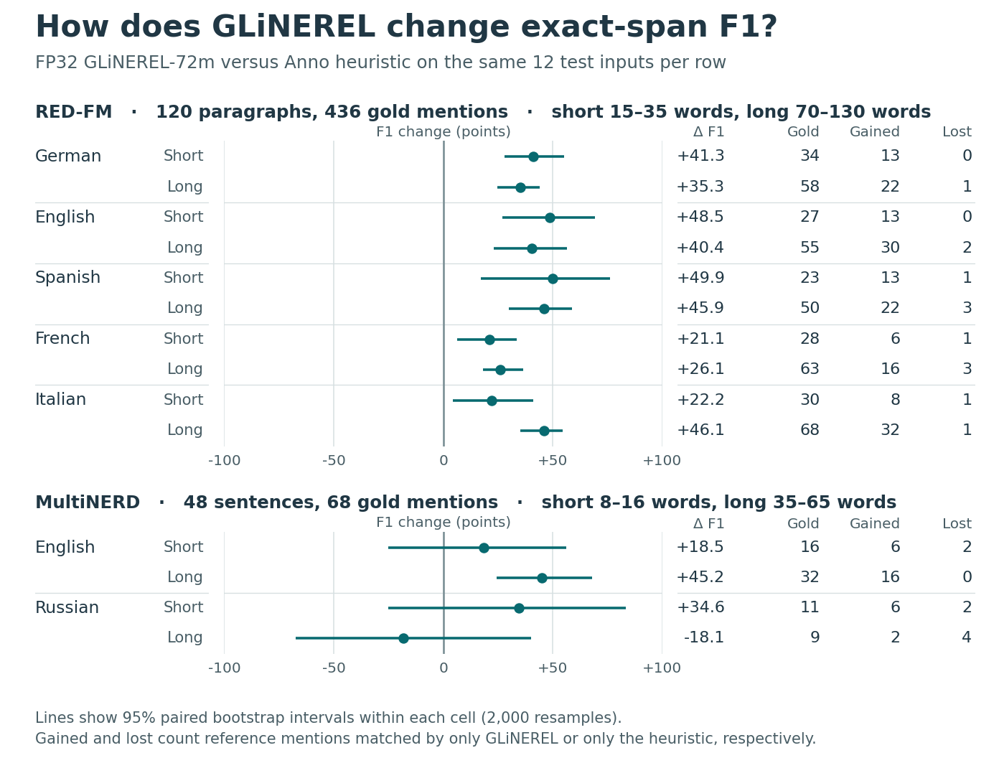

# NER across languages and input lengths

The panel scores exact person, organization and location spans in naturally delimited RED-FM paragraphs. It checks both requested and observed backend, document language, and every returned character span against its source. The same original paragraphs go to all models at each sampling budget.

We used 12 German, English, Spanish, French and Italian paragraphs in **each** of two length bands for both development and test. This yields 120 development and 120 test paragraphs. Short means 15–35 whitespace-delimited words and long means 70–130. Paragraphs outside these bands are ineligible. A stable hash of source identity selects paragraphs before looking at annotations. Each of the 240 paragraphs has a different Wikidata subject, including across languages and splits. Zero-width, empty source annotations contribute no mention and are counted separately in the report. Invalid nonempty spans fail the run. The source files have fixed hashes. The panel fails if a language or length cell cannot be filled.

The external SauerkrautLM-GLiNEREL-72m checkpoint ran on CPU with FP32, glinerel-fast 0.1.1 and the English prompts `person`, `organization`, `location` for every language. Among thresholds 0.3, 0.5 and 0.7, micro F1 on development was 55.4, **57.2** and 54.4 respectively. We froze 0.5 before test inference. The native Anno comparisons used the public `extract` command at 0.5. They used the offline feature configuration without language-specific optional features. These classical model results characterize that configuration and its built-in parameters.

| Test language | Heuristic short / long F1 | External checkpoint short / long F1 |
|---|---:|---:|
| German | 29.3 / 10.1 | 70.6 / 45.5 |
| English | 30.8 / 13.2 | 79.2 / 53.6 |
| Spanish | 23.5 / 15.2 | 73.5 / 61.1 |
| French | 34.5 / 36.4 | 55.6 / 62.5 |
| Italian | 22.5 / 24.5 | 44.8 / 70.6 |

| Test backend | Correct | Unmatched prediction | Missed reference | Exact micro F1 |
|---|---:|---:|---:|---:|
| Anno heuristic | 110 | 467 | 326 | 21.7 |
| Anno CRF | 6 | 37 | 430 | 2.5 |
| Anno HMM | 7 | 228 | 429 | 2.1 |
| External GLiNEREL-72m | 272 | 196 | 164 | 60.2 |

Compared on the same 120 test paragraphs, the external checkpoint recovered **175** reference mentions missed by the heuristic and lost **13** that the heuristic got right. Swapping backends would therefore introduce real regressions even on this favorable comparison.

On this panel, long paragraphs had lower external checkpoint F1 in three languages and higher F1 in two. Topics, entity mixes and annotation density also differ between cells. RED-FM was assembled for relation extraction. Its entity boundaries and types are the scoring reference and can omit real mentions or label them differently. The sample uses European languages with whitespace word boundaries. It gives no estimate for Cyrillic, unspaced scripts, other domains, or languages absent from the panel. We therefore ran a separate English and Russian experiment on MultiNERD.

### Paired GLiNEREL and heuristic results



With 12 test inputs per group, the paired 95% interval favors GLiNEREL in all ten RED-FM groups (436 gold mentions altogether). On MultiNERD (48 test sentences, 68 gold mentions), only long English has an interval wholly above zero, from +24.4 to +68.0 F1 points. On long Russian sentences the checkpoint gained two matches and lost four among nine references. The estimate was −18.1 points, with an interval from −67.5 to +40.0. Each interval compares the two models by resampling whole inputs within one language and length group. [Paired counts and intervals](ner-language-length.json)

### Smaller ONNX panel

A separate four-per-cell run compared native Anno ONNX backends on 40 test subjects with 161 scored reference mentions. It omitted one empty source annotation from a French paragraph while retaining that paragraph. The MIT-licensed [BERT checkpoint](https://huggingface.co/protectai/bert-base-NER-onnx/tree/84d28ab2bc28401b4353b26033eb043c8c8a0739) returned 94 correct, 184 unmatched, and missed 67 (42.8 F1). Anno heuristic on those same paragraphs returned 36 correct, 170 unmatched, and missed 125 (19.6 F1). Native BERT's per-cell test p95 ranged from 2.20 to 4.19 seconds including fresh CLI and model startup per paragraph. It used at most 553 MiB across those processes. The two sampling budgets have different panel digests and denominators. [Aggregate results, runtime identities and checkpoint hashes](ner-language-length.json)

On the same 40 paragraphs, native NuNER Zero returned **125 correct, 128 unmatched and 36 missed** (60.4 F1). It recovered more references than BERT in aggregate with fewer unmatched predictions. Its warm Rust API p95 ranged from 0.30 to 1.17 seconds by cell, with about 3.0 GiB maximum RSS across the worker and CLI parity processes. One held-out paragraph per language matched the independent CLI predictions exactly. The BERT wall times above include a fresh model load. A timing comparison requires identical session lifetimes. The initial cold NuNER run was interrupted under memory contention and contributes no scores.

### Natural Russian and English sentences

The second corpus uses 8–16 versus 35–65 whitespace-delimited words in individual source sentences. We retain each MultiNERD token sequence, join its tokens with spaces and apply the same three-type BIO projection as the [historical NuNER run](nuner-4k-labeled.md). A source language field, exact-file digest and unique reconstructed sentence text are required. MultiNERD's shards do not include source document IDs, so exact text deduplication across validation and test cannot prove article independence. Both controlled panels had **zero** test source-row overlap with the earlier 38 inputs. No threshold was selected using this corpus.

| Test language | Group | Anno heuristic correct / extra / missed | External GLiNEREL-72m correct / extra / missed |
|---|---|---:|---:|
| English | Short | 10 / 3 / 6 | 14 / 2 / 2 |
| English | Long | 15 / 11 / 17 | 31 / 1 / 1 |
| Russian | Short | 2 / 1 / 9 | 6 / 2 / 5 |
| Russian | Long | 5 / 4 / 4 | 3 / 4 / 6 |

Each cell contains 12 test sentences. In the long Russian cell there were only nine reference mentions. The external checkpoint matched three and the heuristic matched five. On long English sentences the same models matched 31 and 15 respectively. The observations motivate separate Russian evaluation, with more naturally long documents and more gold mentions per cell. Switching the external 72m checkpoint to CPU BF16 at the same threshold changed zero predicted span sets on the 48 test sentences. This agreement belongs to that checkpoint, runtime and cohort. NuNER Zero-4k uses a different architecture and quantization method; its paired FP32/QUInt8 precision tradeoff remains a separate experiment.

A separate four-per-cell native comparison used the MIT-licensed [NuNER Zero ONNX export](https://huggingface.co/deepanwa/NuNerZero_onnx/tree/40349bb15d985ced384bed5c35115fd70069f4b9), a different checkpoint from Zero-4k.

| Test cell | Reference | NuNER Zero correct / extra / missed | BERT correct / extra / missed |
|---|---:|---:|---:|
| English short | 7 | 5 / 6 / 2 | 7 / 0 / 0 |
| English long | 16 | 16 / 2 / 0 | 16 / 0 / 0 |
| Russian short | 5 | 3 / 2 / 2 | 0 / 3 / 5 |
| Russian long | 4 | 4 / 5 / 0 | 1 / 3 / 3 |

NuNER recovered all four references on the long Russian sentences and emitted five extra mentions. This small cell illustrates the cost of increased recall. The ranking of the external checkpoint and the heuristic also reversed on long Russian sentences between development and test. A default for Russian would need a larger prospectively sealed sample.

To run this second corpus after reviewing its noncommercial terms, add `--corpus multinerd` and supply a separate external `--data-dir`. `--fetch` downloads the four hash-verified validation and test shards. No text or row-level gold annotations belong in the repository. Simone Tedeschi and Roberto Navigli, *MultiNERD: A Multilingual, Multi-Genre and Fine-Grained Dataset for Named Entity Recognition (and Disambiguation)*, Findings of NAACL 2022. The card lists CC BY-NC-SA 4.0. The reconstruction, sampling and three-label projection are described above. [Dataset revision](https://huggingface.co/datasets/Babelscape/multinerd/tree/2814b78e7af4b5a1f1886fe7ad49632de4d9dd25) · [License](https://creativecommons.org/licenses/by-nc-sa/4.0/) · [Paper](https://aclanthology.org/2022.findings-naacl.60/)

## Replay

Render the paired figure from the checked-in aggregate with Matplotlib. [Figure generator](../../scripts/plot_ner_language_length.py)

```sh
python3 scripts/plot_ner_language_length.py /tmp/anno-ner-figures
```

Use a Linux environment with Python 3.11 or newer and an Anno CLI. The first command fetches ten revision-pinned files into an external directory, verifies their contents and prints only aggregate JSON. Set `--per-cell 4` on every arm for a smaller paired panel. Score files record the panel digest, device/runtime information for the external checkpoint, and the binary or checkpoint fingerprints. Compare scores from identical panel digests. The per-cell p95 CLI timings include launching Anno and initializing the model for each document. The external checkpoint remains loaded between calls. Those resource figures describe different invocation paths.

```sh
python3 scripts/qa/ner_language_length.py --data-dir /tmp/anno-redfm --fetch \
    --anno ./target/release/anno --backend heuristic
python3 scripts/qa/ner_language_length.py --data-dir /tmp/anno-redfm \
    --anno ./target/release/anno --backend crf
python3 scripts/qa/ner_language_length.py --data-dir /tmp/anno-redfm \
    --anno ./target/release/anno --backend hmm
```

For the optional FP32 external comparison, obtain the [72m checkpoint](https://huggingface.co/VAGOsolutions/SauerkrautLM-GLiNEREL-72m) under its LFM Open License v1.0. The four required local file hashes are enforced before model loading. Install glinerel-fast 0.1.1 in an isolated environment. The measured run used PyTorch 2.7.1+cpu. For a precision comparison on identical test sentences use `--precision bf16 --compare-fp32`. With `--compare-heuristic`, the report counts newly recovered and lost gold mentions and estimates 95% percentile intervals for each cell's paired F1 change by resampling whole subject-disjoint paragraphs 2,000 times.

```sh
python3 scripts/qa/ner_language_length.py --data-dir /tmp/anno-redfm --backend sauerkraut \
    --checkpoint /path/to/SauerkrautLM-GLiNEREL-72m --anno ./target/release/anno \
    --calibrate --compare-heuristic
```

For local NuNER or BERT, build Anno with ONNX enabled. Use `--backend nuner` or `--backend bert-onnx` and supply an explicit `--checkpoint` directory. For a fixed 0.5 NuNER comparison, the following holds one public Rust model session open. Each input is bound to the verified source file via the panel selection and its returned UTF-8 text hash. A missing or reordered result, differing requested labels, wrong checkpoint or failed subprocess rejects the run. After the session exits, one test example per language goes through the separate extraction CLI and must return the same exact labeled spans. The public artifact contains only aggregated counts, timings and model fingerprints.

```sh
cargo build --release --locked -p anno --features onnx --example nuner_panel
python3 scripts/qa/ner_language_length.py --corpus multinerd --data-dir /tmp/anno-multinerd \
    --fetch --backend nuner --checkpoint /path/to/nuner-zero --per-cell 4 \
    --anno ./target/release/anno --nuner-worker ./target/release/examples/nuner_panel
```

To measure quantization, run the same panel on separate FP32 and quantized directories with the same verified tokenizer and configuration. The script records artifact hashes and rejects a mismatched runtime or checkpoint selector.

**Dataset attribution.** Pere-Lluís Huguet Cabot, Simone Tedeschi, Axel-Cyrille Ngonga Ngomo and Roberto Navigli, *RED-FM: a Filtered and Multilingual Relation Extraction Dataset*, ACL 2023. The dataset card lists CC BY-SA 4.0. This evaluation selects paragraphs by length and subject and scores three incoming annotation types. Only aggregate counts are published. Keep text, offsets and adapted rows in the external cache and preserve attribution and the applicable ShareAlike terms when redistributing corpus material. The optional external checkpoint has its own license and commercial-use terms. [Dataset revision](https://huggingface.co/datasets/Babelscape/REDFM/tree/eae75dc9bde14d1172351423bcbb82c5b9a94f66) · [CC BY-SA 4.0](https://creativecommons.org/licenses/by-sa/4.0/) · [Model license](https://huggingface.co/VAGOsolutions/SauerkrautLM-GLiNEREL-72m/blob/main/LICENSE)

The [sentence-boundary replay](../../scripts/qa/check_heuristic_sentence_boundaries.py)
uses the same pinned RED-FM test files to compare two heuristic binaries on original
paragraphs and paired Unicode-punctuation edits. It reports exact typed-span gains,
losses, and unmatched predictions for each language.
