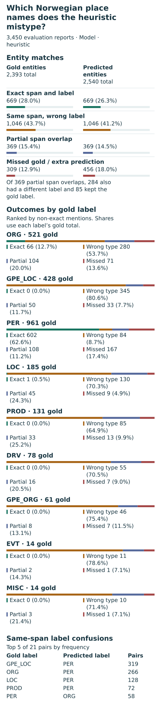
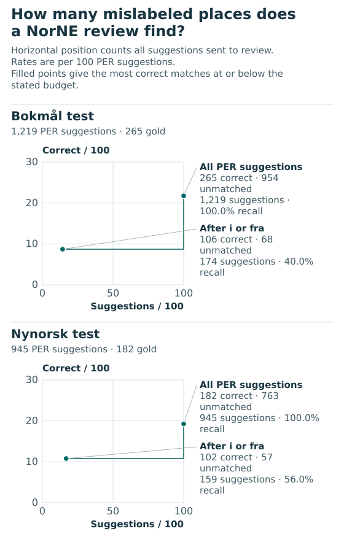
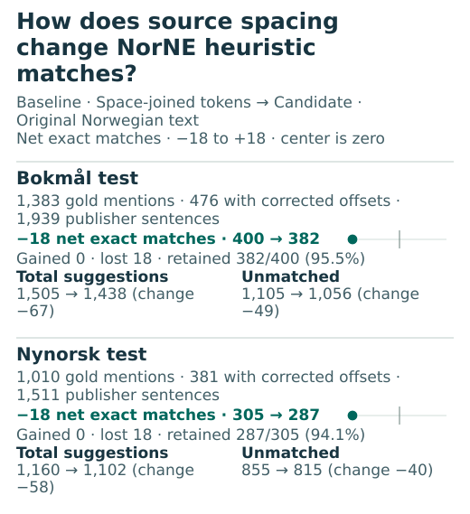

# Why does Anno call Norwegian places people?

**Treat the heuristic’s Norwegian place labels as unreliable.** Across the complete Bokmål and Nynorsk tests, it found the exact boundaries of 345 of 428 geopolitical names used as places (`GPE_LOC`). It called 319 of them people. Even among the 185 ordinary `LOC` mentions, only one received the correct type and boundaries. Another 128 had the right boundaries and came back as people. [Native error counts](norne-test-errors.json) · [Counts by written standard and source label](norne-source-replay.json)



| Test gold type | Gold | Exact type and span | Exact span, different type | Overlap only | No overlapping suggestion |
|---|---:|---:|---:|---:|---:|
| GPE_LOC | 428 | 0 | 345 | 62 | 21 |
| LOC | 185 | 1 | 130 | 47 | 7 |
| ORG | 521 | 66 | 280 | 125 | 50 |
| PER | 961 | 602 | 84 | 145 | 130 |

The heuristic emitted only `PER`, `ORG` and `LOC` on both tests. The authors also define a seven-type scoring scheme that treats `GPE_LOC` as `LOC` and `GPE_ORG` as `ORG`. Applying that scheme to the same predictions credits only 39 additional mentions across the two tests, from 669 to 708. Changing the scoring vocabulary leaves the 319 person predictions intact. [Publisher’s type definitions](https://github.com/ltgoslo/norne/blob/0c0d133a0f9590d76b81078712261badd4b605e9/README.md#entity-types)

## Which person suggestions should a reviewer inspect first?

Start with person suggestions immediately following a token written *i* or *fra*, ignoring case. We tested this cue after seeing the place errors. On the two test splits a reviewer inspecting 333 of 2,164 person suggestions would find 208 of the 447 exact places that the heuristic labelled as people. The share of reviewed suggestions that were exact places rose from 20.7% to 62.5%. The queue surfaces 46.5% of the target errors at 15.4% of the review workload. [Review counts and exact rule](norne-place-review.json)



Both axes use the full queue as their denominator. For every 100 person suggestions, the horizontal axis shows how many go to review and the vertical axis shows how many confirmed place errors the reviewer finds. The cue uses the two literal tokens and excludes the Nynorsk spelling *frå*. [Accessible chart and operating points](../figures/norne-place-tradeoff.html)

| Publisher split | Exact places / all PER suggestions | Exact places / flagged suggestions | Place yield among flagged | Correct people also flagged |
|---|---:|---:|---:|---:|
| Bokmål dev | 294 / 1,427 | 108 / 184 | 58.7% | 10 |
| Nynorsk dev | 229 / 1,127 | 128 / 174 | 73.6% | 2 |
| Bokmål test | 265 / 1,219 | 106 / 174 | 60.9% | 7 |
| Nynorsk test | 182 / 945 | 102 / 159 | 64.2% | 4 |

Sixteen test sentences repeated a text from either development split, nine in Bokmål and seven in Nynorsk. They contributed four person suggestions and zero flags. Keep this cue in human review. Automatically labelling every flagged test span as a place would also change 11 correctly identified people. Another 59 flags exactly matched an entity of another type, 54 partially overlapped an annotation and one touched no annotation. Before changing a default, compare a candidate on fresh Norwegian documents and count the correct people it displaces alongside the places it recovers. [Review script](../../scripts/qa/norne_place_review.py)

## What changed when Anno read the original sentences?

The earlier two-column cache added a space between every pair of word tokens. Across both written standards and all three splits, that inserted 65,130 spaces and changed 35,130 of 37,620 sentences. Only 17,387 of the 28,406 gold mentions still had their source coordinates. The repaired reader recovered all 37,620 publisher strings and all 28,406 labelled Unicode spans. A text digest and a separate fingerprint for every labelled span verified the result against the words, spacing and tags in the six original files. [Six-split receipt](norne-source-replay.json)



| Written standard and split | Sentences | Gold | Space-joined exact / suggestions | Original exact / suggestions | Original precision | Original recall |
|---|---:|---:|---:|---:|---:|---:|
| Bokmål train | 15,696 | 11,403 | 3,314 / 12,188 | 3,108 / 11,575 | 26.9% | 27.3% |
| Bokmål dev | 2,410 | 1,688 | 468 / 1,766 | 436 / 1,689 | 25.8% | 25.8% |
| **Bokmål test** | **1,939** | **1,383** | **400 / 1,505** | **382 / 1,438** | **26.6%** | **27.6%** |
| Nynorsk train | 14,174 | 11,668 | 3,421 / 12,696 | 3,159 / 12,156 | 26.0% | 27.1% |
| Nynorsk dev | 1,890 | 1,254 | 378 / 1,391 | 352 / 1,336 | 26.3% | 28.1% |
| **Nynorsk test** | **1,511** | **1,010** | **305 / 1,160** | **287 / 1,102** | **26.0%** | **28.4%** |

Use the original-text column for comparisons with future backends. On the two tests, correcting the text moved 857 gold highlights. After we translated old suggestions into source coordinates, 774 suggestions merely moved and 1,695 kept the same offsets. The heuristic also produced 71 new typed spans and stopped producing 196 old ones. These changes affected 117 of 3,450 test sentences. Of the 36 previously correct mentions it lost, 35 still overlapped a suggestion with different boundaries and one had no overlapping prediction. It gained zero exact mentions. [Paired gold identities and suggestion counts](norne-source-replay.json) · [Accessible test comparison](../figures/norne-source-paired.html)

## Scope and replay

The study includes all 611,575 word and punctuation tokens from the authors’ six `ud/` files. A cold Anno download uses Nynorsk test. The replay measures both written standards and the three splits separately. It evaluates the flat `name=` BIO layer with its literal source types. A correct mention needs its exact type and half-open Unicode character range. Each source sentence has one `# text` header and each indexed word carries exactly one `name=` tag. The separate `ndt/` distribution, syntax annotations and other backends are outside this score. The train rows describe the input pipeline. The heuristic fits no parameters in this replay. [NorNE distribution](https://github.com/ltgoslo/norne/tree/0c0d133a0f9590d76b81078712261badd4b605e9/ud)

The replay checks every `anno dataset eval` row against the author’s text and tags and every `anno batch` prediction against the corresponding Unicode substring. It compares exact matches by source split, sentence and mention ordinal. For predictions, it maps both endpoints onto the publisher text and pairs identical type and extent, retaining multiplicity. The error chart pools only the native test reports. Its gold, suggestion and exact-match totals and every same-boundary type confusion must agree with the independently paired predictions.

```sh
cargo build --locked -p anno-cli --no-default-features --features eval,extractor-html2text
ANNO="$PWD/target/debug/anno"
python3 scripts/build_offline_native_cache.py ./norne-cache \
  --anno "$ANNO" --dataset NorNE --fetch
python3 scripts/qa/norne_source_replay.py --anno "$ANNO" \
  --archive ./norne-cache/anno-native-cache-dataset-NorNE.zip \
  --output norne-source-replay.json --errors-output norne-test-errors.json
python3 scripts/qa/norne_place_review.py --anno "$ANNO" \
  --archive ./norne-cache/anno-native-cache-dataset-NorNE.zip \
  --output norne-place-review.json
python3 scripts/qa/norne_place_review.py --tradeoff-from norne-place-review.json \
  --output norne-place-tradeoff.json
"$ANNO" viz render norne-test-errors.json -o norne-test-errors.html
"$ANNO" viz render norne-place-tradeoff.json -o norne-place-tradeoff.html
```

With a custom Cargo target directory, set `ANNO` to the executable built there. The replay also accepts an older complete native archive containing the six CoNLL-U originals. To verify the old-cache arm independently, add `--prior-anno` with a binary built at `136a7e7aea5c8abc6b722822c2b5f5473f5ede88`. The measurement runs offline and publishes counts and digests. The original archive carries the corpus license and credits. The annotations are CC0, and the release prohibits republishing individual third-party works as standalone texts. [Replay script](../../scripts/qa/norne_source_replay.py) · [Publisher’s terms](https://github.com/ltgoslo/norne/blob/0c0d133a0f9590d76b81078712261badd4b605e9/LICENSE_NDT.txt)

To repeat the full measurement in CI, run **Dataset figures** with `with_norne_replay` enabled. The runner downloads the original files and their notices into a temporary directory, reruns the heuristic, and compares all three aggregate reports with the checked-in results before building the figure artifact. [Dataset figures workflow](https://github.com/arclabs561/anno/actions/workflows/dataset-figures.yml)
