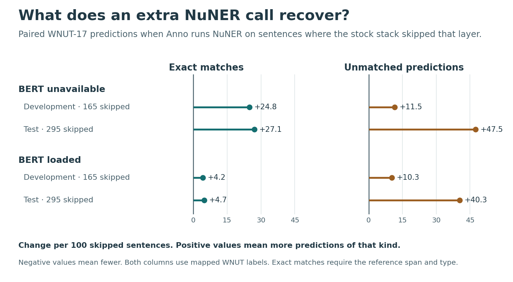

# When should the stacked backend run NuNER?

The default stack tries BERT and NuNER independently. When NuNER loads, Anno can skip it on a sentence based on length and casing. If BERT failed to load, this can leave regex and heuristics as the only layers that processed that sentence. We tested whether paying for the skipped inference improves the entities a caller actually receives. [Stack construction and per-sentence scheduling](../../crates/anno/src/backends/stacked/mod.rs)



| WNUT split | BERT | NuNER calls added | Exact gained | Exact lost | In-schema unmatched added | In-schema unmatched removed | Warm p95, stock → extra call |
|---|---|---:|---:|---:|---:|---:|---:|
| Development | Unavailable | 165 | 43 | 2 | 44 | 25 | 0.9 → 212.9 ms |
| Development | Available | 165 | 7 | 0 | 20 | 3 | 85.7 → 345.2 ms |
| Test | Unavailable | 295 | 82 | 2 | 186 | 46 | 1.5 → 327.3 ms |
| Test | Available | 295 | 14 | 0 | 126 | 7 | 112.4 → 478.4 ms |

Keep the fast path when BERT succeeds. On test, running NuNER anyway recovered 14 exact mentions for 119 net extra unmatched predictions. Full-split projected F1 fell from 37.0% to 36.2%. Without BERT, the extra calls recovered 82 exact mentions, lost two and produced 140 net extra unmatched predictions. Full-split projected F1 rose from 35.2% to 38.0%. Rust callers can enable the fallback when BERT is unavailable. The WikiGold comparison below tests that configuration on encyclopedia text. An independent two-stack study measures how the tradeoff changes when BERT loads successfully. [WikiGold counts, warm timings and routing figure](wikigold-nuner-routing.md)

What should developers inspect next? Without BERT, 132 of the 186 newly unmatched test outputs did not overlap any annotated name. Of the other 54, 27 had the right boundary and wrong type, and 27 overlapped with a different boundary. A boundary-only fix could address a minority of these outputs. Of the 82 exact gains, 75 were names unseen in training. With BERT, 107 of 126 newly unmatched outputs had no reference overlap. Human review of a sample from that group can distinguish spurious suggestions from legitimate unannotated names.

## Does the fallback help on encyclopedia text?

On WikiGold, the stock gate skipped NuNER on 313 of 1,696 sentences. With BERT unavailable, both arms used the production default constructor with the pinned NuNER graph in an isolated, offline model cache. The guarded candidate recovered 220 exact mentions and lost 16 across the 731 annotated mentions on those sentences. Exact recall on the skipped subset rose from 31.6% (231/731) to 59.5% (435/731). In-schema unmatched predictions fell from 307 to 274, with 115 added and 148 removed. Both arms emitted 102 predictions outside the annotation inventory. Unlike the WNUT result, recovering more mentions here also reduced the total number of unmatched predictions. Human review time was not measured. [WikiGold publication](https://aclanthology.org/W09-3302/) · [Aggregate receipt](nuner-fallback-wikigold.json)

All 16 already-routed controls, selected by sentence digest, retained their ordered predictions. Warm p95 on the 313 skipped inputs rose from 1.56 ms to 1.72 s. This Linux development build used two CPUs on a shared host. Rust callers can select this behavior using `StackedNER::default().with_nuner_fallback()` or `builder.build().with_nuner_fallback()`. The setting applies per input. A successful BERT inference returning zero entities counts as a success. Strict extraction continues to report a failed BERT inference even when NuNER recovers entities. These timings do not establish a production latency budget, and deliberately withholding BERT does not measure how often a deployment lacks it.

For reproduction on current code, build the stock worker using the first build in the recipe below. The scorer runs the stock and opt-in settings on that binary. To reproduce the original two-binary receipt, use commit `4f4e9e12` and supply `--candidate "$trial/guarded"`. Both historical workers used the production backend sources from `89c5acc2`, with the routing patch applied only to the candidate. Put the three pinned NuNER files in `$models/NuNerZero_onnx/`, set `LD_LIBRARY_PATH` to the pinned ONNX Runtime 1.24.2 CPU library, then run the commands below. The scorer reconstructs the publisher's blank-line-delimited sentences with single spaces, joins adjacent identical I-tags, and scores exact character boundaries and types over PER, ORG, LOC and MISC. [Scorer](../../scripts/qa/checkpoint_replay/wikigold_routing.py) · [Pinned corpus](https://github.com/juand-r/entity-recognition-datasets/blob/8522f4b39cf9ed323b77f2d8a5005628f8861908/data/wikigold/CONLL-format/data/wikigold.conll.txt)

```sh
ANNO_CACHE_DIR="$trial" bash scripts/qa/prepare_matrix_wikigold.sh
python3 scripts/qa/checkpoint_replay/wikigold_routing.py \
  --data "$trial/datasets/WikiGold.cache" --models "$models" \
  --stock "$trial/stock" --output "$trial/wikigold.json"
```

## Which names should NuNER recognize?

The loaded NuNER backend prompts for people, organizations and locations. Products and creative works make up 269 of 1,079 test mentions, including 80 of the 264 on skipped sentences. Changing the routing rule alone cannot make NuNER recognize these two types under their own labels. A separate development trial can add the two prompts and map their outputs to the corresponding Anno labels. Count exact products and works gained, correct entities of existing types lost, new unmatched predictions and latency at the same threshold. Develop the prompt on development data and evaluate on an independently held-out source before changing a shared default. [Loaded NuNER label inventory and mapping](../../crates/anno/src/backends/nuner/inference.rs) · [Source label counts](nuner-fallback-routing.json)

## What was measured

- All 1,009 development and 1,287 test sentence occurrences in the pinned English WNUT-17 release went through the native stock stack under both BERT conditions. These include sentences with zero gold entities. The 3,394 training sentences establish prior name exposure. Test contributes 1,079 gold mentions and development contributes 836. No training examples were scored. The source consists of tokenized sentences reconstructed with single spaces. [Publisher files](https://github.com/leondz/emerging_entities_17/tree/e52a2d2a71ac1a051ca2d532eef28653c5c02603)
- The stock stack runs NuNER for text under 30 UTF-8 bytes or for a qualifying consecutive pair of words with lowercase initials. It skipped 165 development and 295 test sentences. We ran the candidate on every one of them. The fallback patch permits skipping NuNER only after an earlier BERT layer succeeded on the same input. With a working BERT we used a separate diagnostic that forces NuNER to run. Regex, heuristics, layer priority, span healing, NuNER's 0.90 threshold and the final 0.50 confidence filter were held fixed. [Native driver](../../crates/anno/examples/stacked_nuner_routing.rs) · [Fallback patch](../../scripts/qa/fixtures/nuner-fallback-routing.patch) · [Forced-call patch](../../scripts/qa/fixtures/nuner-always-routing.patch)
- The stock binary ran on every input. Each split and topology included eight already-routed inputs selected by sentence hash. Their ordered outputs agreed between arms. Full-split candidate counts reuse stock predictions for other inputs where the route was identical. On a healthy BERT stack the fallback patch also matched stock routing and output on eight skipped and eight already-routed inputs per split. The worker required successful inference from every attempted layer and checked each Unicode character span against the source. A mid-sentence BERT inference failure is covered separately by the patch's unit tests.
- Exact means the final character span and mapped entity type both agree. WNUT corporations and groups map to ORG. All six source types remain in the gold counts. An unmatched prediction is an output in the mapped inventory without an exact reference match. Some may be valid names outside the annotation. The receipt separately records outputs outside that inventory. An unfamiliar name has no case-folded surface match among training entities. [Scoring and input validation](../../scripts/qa/nuner_fallback_routing.py)
- Timings are warm, individual final-stack calls on one Linux CPU host, using FP32 ONNX Runtime 1.24.2, a four-CPU quota and a Rust development build. They exclude weight loading, input parsing and scoring. Hardware, concurrency and the prevalence of missing BERT in a deployment will change the operational cost. Other languages, domains, quantized weights, accelerators and the configuration with neither neural model available fall outside this comparison. [Counts, timings and SHA-256 pins](nuner-fallback-routing.json)

## Reproduce the comparison

Use a disposable checkout at the commit that introduced this study. Its backend sources match the recorded Anno baseline `75f961e`. Set `WNUT` to the directory containing the three pinned source files. Set `NUNER` and `BERT` to local directories containing the FP32 graph as `model.onnx`, its tokenizer and its configuration. The scorer verifies every listed file digest. Use an ONNX-enabled Rust build environment, Python 3.11 or newer on Linux and the same source revision for all three workers. [NuNER checkpoint](https://huggingface.co/deepanwa/NuNerZero_onnx/tree/40349bb15d985ced384bed5c35115fd70069f4b9) · [BERT checkpoint](https://huggingface.co/protectai/bert-base-NER-onnx/tree/84d28ab2bc28401b4353b26033eb043c8c8a0739)

```sh
set -eu
trial=$(mktemp -d)
worker="${CARGO_TARGET_DIR:-target}/debug/examples/stacked_nuner_routing"
build_worker() {
    cargo build --locked -p anno --no-default-features --features onnx --example stacked_nuner_routing
    cp "$worker" "$trial/$1"
}
build_worker stock
git apply scripts/qa/fixtures/nuner-fallback-routing.patch
cargo test --locked -p anno --no-default-features --lib backends::stacked::tests
build_worker guarded
git apply -R scripts/qa/fixtures/nuner-fallback-routing.patch
git apply scripts/qa/fixtures/nuner-always-routing.patch
build_worker always
git apply -R scripts/qa/fixtures/nuner-always-routing.patch

python3 scripts/qa/nuner_fallback_routing.py \
  --stock "$trial/stock" --candidate "$trial/guarded" --always "$trial/always" \
  --checkpoint "$NUNER" --bert "$BERT" --data "$WNUT" --output "$trial/routing.json"
uv run --python 3.12 --with matplotlib==3.10.8 python scripts/plot_nuner_routing.py "$trial/routing.json" "$trial/figures"
```

The **Dataset figures** CI workflow rebuilds the published PNG and SVG from the checked-in receipt alongside the other dataset figures. Its downloadable artifact lasts 30 days. [Figure index and CI downloads](../figures/README.md)
