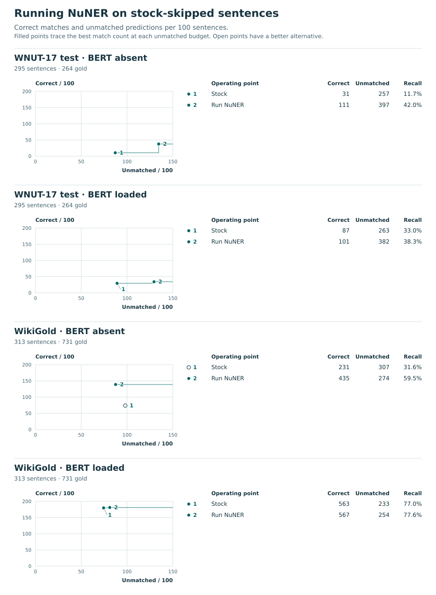
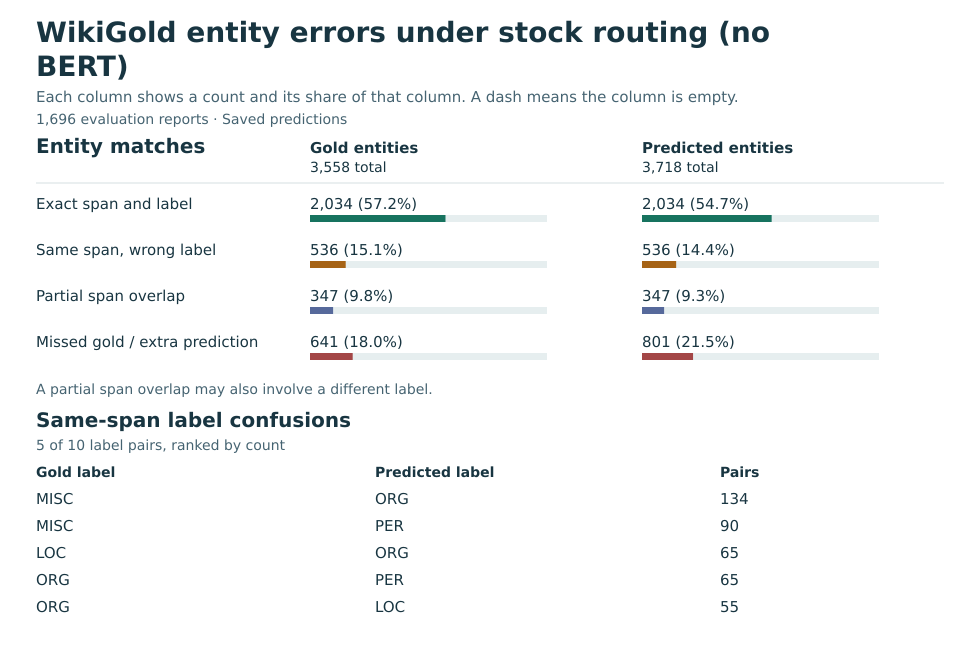

# Does the NuNER fallback transfer to encyclopedia text?

When BERT was unavailable, running NuNER on the 313 WikiGold sentences the default stack skipped raised exact entity matches from **231 to 435** and reduced unmatched predictions from **307 to 274**. With BERT loaded, the same extra calls gained four exact matches and added 21 net unmatched predictions. Keep the fast path when BERT succeeds. A caller who wants higher recall when BERT fails has evidence for paying for the additional calls on both WikiGold and WNUT. The time and review costs differ by corpus. [WikiGold counts and model identities](wikigold-nuner-routing.json) · [WNUT routing trial](nuner-fallback-routing.md)

Rust callers can select the measured fallback with `StackedNER::default().with_nuner_fallback()`. A separate native replay of the BERT-absent configuration on the same WikiGold release reproduced the exact gains and losses. [Caller behavior and independent replay](nuner-fallback-routing.md#does-the-fallback-help-on-encyclopedia-text)



| Corpus and BERT state | Extra calls | Gold on these inputs | Exact gained / lost | Unmatched added / removed | F1 on full corpus or test split, stock → extra call |
|---|---:|---:|---:|---:|---:|
| WikiGold, absent | 313 | 731 | 220 / 16 | 115 / 148 | 58.1% → 62.5% |
| WikiGold, loaded | 313 | 731 | 4 / 0 | 23 / 2 | 73.7% → 73.5% |
| WNUT-17 test, absent | 295 | 264 | 82 / 2 | 186 / 46 | 35.2% → 38.0% |
| WNUT-17 test, loaded | 295 | 264 | 14 / 0 | 126 / 7 | 37.0% → 36.2% |

Each chart panel compares the two policies on the same skipped sentences. The F1 column uses all 1,696 WikiGold sentences or all 1,287 WNUT test sentences. An exact match requires both the Unicode character span and the mapped type. WikiGold scores PER, ORG, LOC and MISC. WNUT maps groups and corporations to ORG and includes products and creative works. Both retain all source gold types. The inference thresholds, FP32 checkpoints and stack order match between the studies. [Inputs to the native chart](wikigold-routing-tradeoff.json)

For a WikiGold reviewer seeing every in-inventory prediction, the BERT-absent fallback produces **171 more suggestions** on the skipped inputs. Its 204 net new exact matches account for that increase even though the unmatched count falls by 33. Of the 115 newly unmatched outputs, 31 had the right span with a different type, 60 overlapped an annotated span with a different boundary, and 24 had no reference overlap. On WNUT, 132 of 186 newly unmatched outputs had no overlap. A useful next test for WikiGold is to rerank competing extents and types on those 91 overlapping predictions while counting the exact spans lost in the same sentences. [Paired additions and removals](wikigold-nuner-routing.json) · [WNUT error breakdown](nuner-fallback-routing.json)

## Which types benefit?

The BERT-absent fallback gained 82 exact PER, 76 LOC and 62 ORG mentions on WikiGold. It lost two PER, two LOC and twelve ORG. NuNER's three prompts offered no path to the 145 gold MISC mentions on those skipped inputs. All four exact gains with BERT present were ORG. [Counts by gold type](wikigold-nuner-routing.json) · [NuNER prompt and output mapping](../../crates/anno/src/backends/nuner/inference.rs)



The BERT-absent stock stack emitted zero MISC predictions across the **712 gold MISC mentions**. Anno's one-to-one entity matcher found **263 (36.9%)** at exactly the right boundaries with another label. It called 134 ORG, 90 PER and 39 LOC. Another 121 partially matched a predicted span, and 328 had no paired prediction. To test a MISC prompt and output mapping, count how many of the 263 acquire the right type and how many currently correct PER, ORG or LOC predictions the new prompt displaces. [Native error counts and label pairs](wikigold-entity-errors.json) · [Error-view replay](../../scripts/qa/wikigold_entity_errors.py)

The error chart counts all 3,718 stock predictions, including 280 outside the routing trial's four-label inventory. Its one-to-one matcher distinguishes 536 same-span type errors, 347 partial overlaps and 801 unpaired extra predictions. The routing table counts each in-inventory prediction that lacks an exact span-and-type match as unmatched. [Chart input and full error counts](wikigold-entity-errors.json)

With BERT loaded, its adapter emits the checkpoint's MISC class as the custom Anno label `misc`. The WikiGold scorer maps this spelling to the publisher's `MISC`. Both policies emitted 857 such spans and matched 497 exactly over the full corpus. This mapping lets a caller distinguish support for the class in BERT from the missing prompt in NuNER. [BERT label mapping](../../crates/anno/src/backends/onnx.rs) · [Alias and exact-match counts](wikigold-nuner-routing.json)

## What does an extra call cost?

| BERT | Gained exact without new unmatched | Gained exact and added unmatched | Added unmatched without gain | Neither | Warm median, ms | Warm p95, ms |
|---|---:|---:|---:|---:|---:|---:|
| Absent | 115 | 33 | 57 | 108 | 0.2 → 640.7 | 1.1 → 1,088.6 |
| Loaded | 4 | 0 | 22 | 287 | 78.0 → 829.1 | 145.0 → 1,416.7 |

The first four columns count sentences. A gain means at least one newly exact mention. A sentence can also lose an existing exact match. Times show stock → extra NuNER inference over the same 313 previously skipped sentences, in release order, after warm-up. They measure the final stack call and exclude model loading, input parsing and scoring. The development-build workers used FP32 ONNX Runtime 1.24.2 on a shared Linux host with a four-CPU quota. The process that assembled the receipt used logical CPUs 0 and 1. The separate timing workers used CPUs 3 and 4. WNUT timings came from a different run. [Timing counts and distributions](wikigold-nuner-routing.json)

## What reached the evaluator

The complete, unsplit English WikiGold release contains 145 document groups, 1,696 sentence occurrences, 39,007 tokens and 3,558 gold mentions. The replay retained all 355 sentences with zero gold mentions and all nine repeated sentence occurrences (1,687 distinct strings). It excluded 145 standalone document delimiters. Offsets index Unicode characters after joining tokens with one space. An initial or type-changing I tag begins a mention. Consecutive I tags of the same type extend it. WikiGold supplies no training split, so this comparison pools familiar and unfamiliar names. [Pinned publisher file](https://github.com/juand-r/entity-recognition-datasets/blob/8522f4b39cf9ed323b77f2d8a5005628f8861908/data/wikigold/CONLL-format/data/wikigold.conll.txt) · [Span reader](../../scripts/qa/replay_wikigold.py)

The study used local publisher bytes. Their SHA-256 matches the WikiGold S3 payload. The scorer hashes each reconstructed sentence, surface, type and offset in native evaluator order. The result matches the Rust loader's authenticated cold-S3 receipt. CI independently reproduced the file and span hashes on November 27. [Matched S3 and publisher files](s3-publisher-file-matches.csv) · [Cold-cache verification](https://github.com/arclabs561/anno/actions/runs/46032959618/artifacts/15214793714) · [Native probe](../../crates/anno-eval/examples/wikigold_cache_probe.rs)

The stock stack processed all 1,696 inputs with BERT absent and again with BERT required to succeed. Its length and casing rule skipped NuNER on 313 and ran it on 1,383. Each candidate ran NuNER on all 313 skipped inputs. Eight controls per condition verified that the already-routed path reproduced the stock spans. Candidate totals use the measured stock outputs for the other 1,375 already-routed sentences. Sixteen additional controls checked that the guarded fallback preserves both stock routes when BERT succeeds. The timing runs reproduced the same routing decisions and ordered spans for all 313 inputs under every policy. [Native worker](../../crates/anno/examples/stacked_nuner_routing.rs) · [Scorer and recorded input checks](../../scripts/qa/wikigold_nuner_routing.py)

## Reproduce

Use the three native workers and model files from the WNUT trial. Set `trial`, `NUNER` and `BERT` as in its build instructions. The recorded executables match the WNUT workers byte for byte. Their backend baseline was `75f961e`. The replay verifies the source, checkpoint files and reconstructed gold spans. [Build the workers](nuner-fallback-routing.md#reproduce-the-comparison) · [Prepare the pinned WikiGold input](../../scripts/qa/prepare_matrix_wikigold.sh)

```sh
export ANNO_CACHE_DIR="${ANNO_CACHE_DIR:-$trial/cache}"
bash scripts/qa/prepare_matrix_wikigold.sh
python3 scripts/qa/wikigold_nuner_routing.py replay \
  --stock "$trial/stock" --candidate "$trial/guarded" --always "$trial/always" \
  --checkpoint "$NUNER" --bert "$BERT" --data "$ANNO_CACHE_DIR/datasets/WikiGold.cache" \
  --output "$trial/wikigold.json" --chart "$trial/chart.json"
```

The committed measurements also reproduce both figures offline.

```sh
python3 scripts/qa/wikigold_nuner_routing.py chart \
  docs/eval/wikigold-nuner-routing.json "$trial/recorded-chart.json"
anno viz tradeoff "$trial/recorded-chart.json" -o "$trial/recorded-chart.svg"
anno viz errors docs/eval/wikigold-entity-errors.json -o "$trial/errors.svg"
```

To recompute the error counts from the full stock output, use the same pinned files and the native evaluator.

```sh
python3 scripts/qa/wikigold_entity_errors.py --anno anno \
  --data "$ANNO_CACHE_DIR/datasets/WikiGold.cache" --stock-worker "$trial/stock" \
  --checkpoint "$NUNER" --output-dir "$trial/errors"
```
